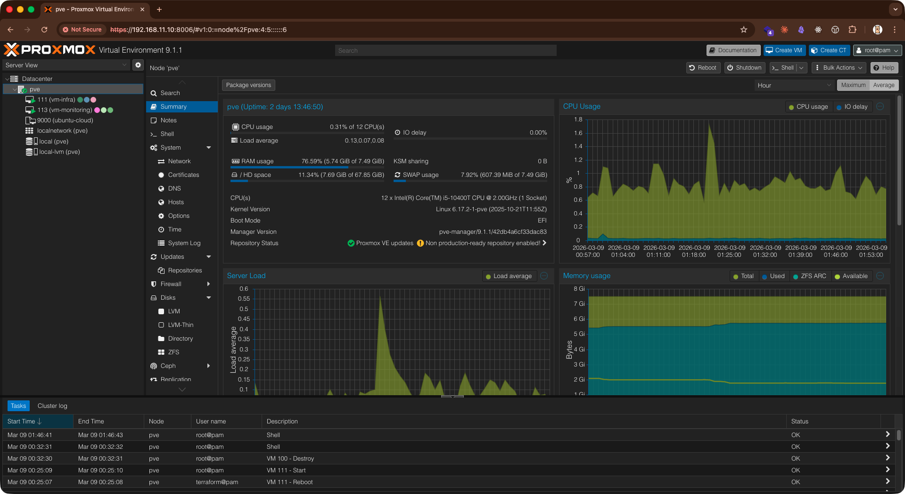
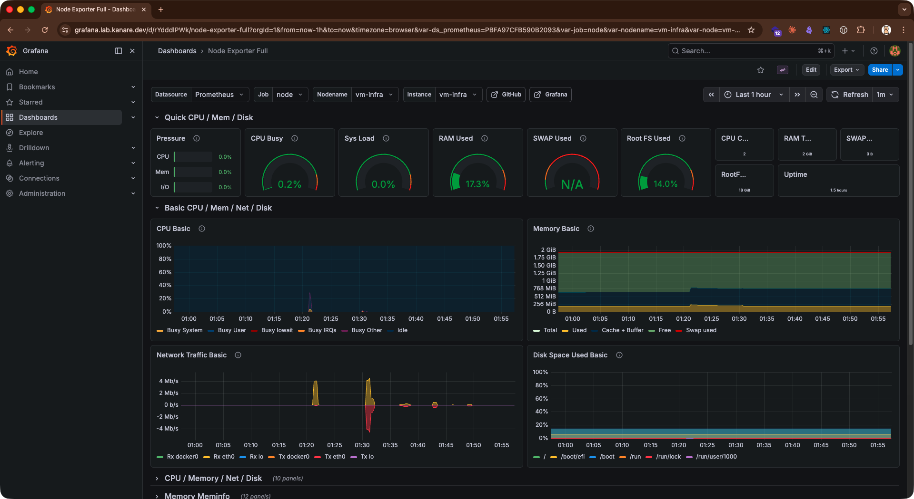
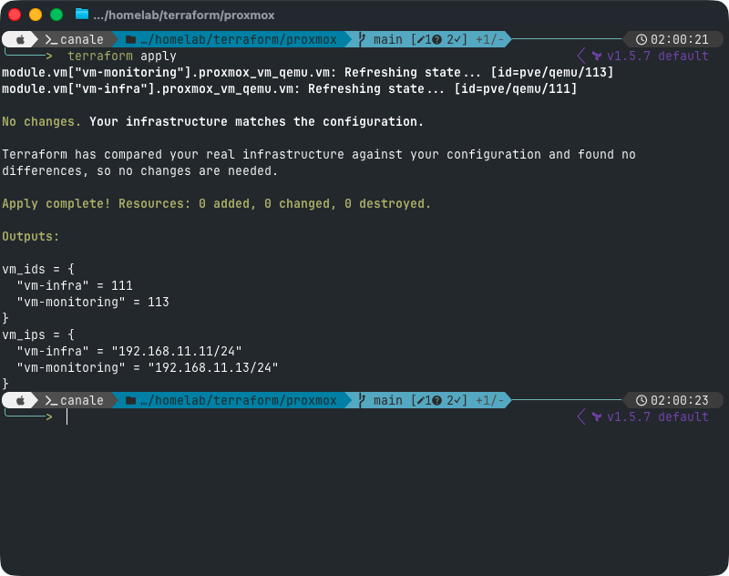
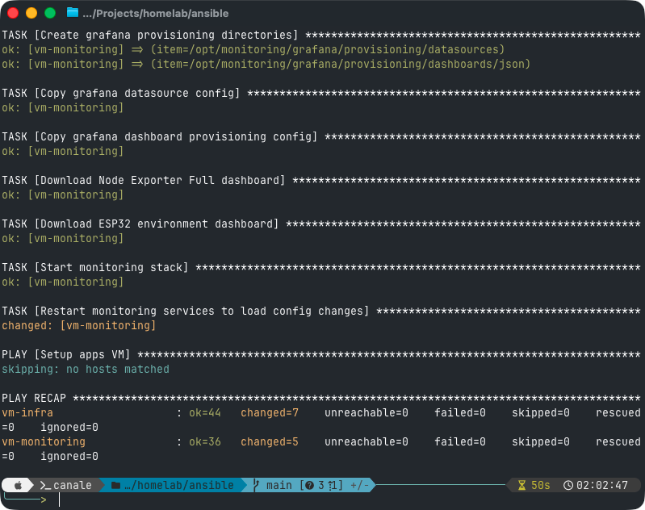

# homelab

[](https://github.com/kanare-dev/homelab/actions/workflows/lint.yml)

Proxmox 上に複数 VM を構築し、Terraform + Ansible + Docker Compose で再現可能に運用する homelab リポジトリ。

24GB RAM の ThinkCentre Tiny 1 台で、DNS・リバースプロキシ・監視・リモート開発環境を常時運用している。構成はすべてコードで管理し、機密値は SOPS + age で暗号化して公開リポジトリに置いている。

## 思想

- **再現可能性**: すべての構成をコードで管理し、いつでも同じ環境を再構築できる
- **最小構成から育てる**: まずは軽量な構成で動かし、必要に応じて段階的に拡張する
- **ドキュメント駆動**: このリポジトリを読めば全体像、命名規約、セットアップ手順が分かる
- **観測可能性**: Prometheus と Grafana で VM やサービスの状態を継続的に可視化し、異常は Slack に通知する

## 構成図


最新の構成図（テキスト版）と、VM ごとの割当（CPU・メモリ・ディスク）は [システム構成・環境](docs/architecture/01-overview.md) を参照。

## 構成の概要

| 名前 | VMID | IP | 状態 | 役割 | 主なサービス |
| --- | --- | --- | --- | --- | --- |
| Proxmox | — | `192.168.11.10` | 常時起動 | ハイパーバイザ | Proxmox VE |
| `vm-infra` | `111` | `192.168.11.11` | 常時起動 | インフラ基盤 | AdGuard Home, Unbound, CoreDNS, Caddy, Tailscale |
| `vm-monitoring` | `113` | `192.168.11.13` | 常時起動 | 監視 | Prometheus, Alertmanager, Grafana, blackbox-exporter |
| `vm-apps` | `120` | `192.168.11.20` | 常時起動 | アプリ | Homepage |
| `vm-code` | `122` | `192.168.11.22` | 常時起動 | 常用リモート開発 | Claude Code, CloudCLI, code-server |
| `vm-dev` | `121` | `192.168.11.21` | 任意起動 | 開発・実験 | playground |

ハードウェアは Lenovo ThinkCentre M70q Tiny（i5-10400T / 24GB RAM / 256GB NVMe）。メモリの配分は [性能・拡張性](docs/architecture/02-infrastructure.md) を参照。

## 技術スタック

| レイヤ | 採用技術 | 用途 |
| --- | --- | --- |
| ハイパーバイザ | Proxmox VE | VM の作成・実行・管理 |
| IaC | Terraform | Proxmox 上の VM プロビジョニング |
| 構成管理 | Ansible | OS 初期設定、Docker、node_exporter、監視基盤のデプロイ |
| コンテナ実行 | Docker Compose | Prometheus、Grafana、reverse proxy、Homepage の起動 |
| 監視 | Prometheus, Alertmanager, Grafana, node_exporter | VM / ホストのメトリクス収集と可視化 |
| ネットワーク | AdGuard Home, Unbound, CoreDNS, Caddy, Tailscale | DNS フィルタリング・フル再帰解決・内部権威 DNS、reverse proxy、VPN（サブネットルーター） |
| TLS 証明書 | Let's Encrypt + Cloudflare DNS-01 | LAN 内サービスへの正規証明書発行 |
| 秘密情報管理 | SOPS + age | 機密情報を暗号化して Git で管理 |

## ドキュメント

| ディレクトリ | 内容 |
| --- | --- |
| [docs/architecture/](docs/architecture/README.md) | 方式設計。[システム概要](docs/architecture/01-overview.md)、[インフラ構成](docs/architecture/02-infrastructure.md)、[ネットワーク設計](docs/architecture/03-network.md)、[可用性・信頼性](docs/architecture/04-reliability.md)、[セキュリティ](docs/architecture/05-security.md)、[移行性](docs/architecture/06-migration.md)、[災害対策](docs/architecture/07-disaster-recovery.md)、[VLAN 設計](docs/architecture/08-vlan-design.md) |
| [docs/services/](docs/services/dns.md) | サービスごとの詳細設計。[DNS](docs/services/dns.md)、[リバースプロキシと TLS](docs/services/reverse-proxy-tls.md)、[監視・アラート](docs/services/monitoring.md)、[CI/CD](docs/services/cicd.md) |
| [docs/operations/](docs/operations/runbooks/README.md) | 運用。[Runbook](docs/operations/runbooks/README.md)、[バックアップ・復旧](docs/operations/backup-restore.md)、障害記録、[ロードマップ](docs/operations/roadmap.md) |
| [docs/adr/](docs/adr/README.md) | 設計判断の記録（ADR） |

## 主な設計の特徴

- **3 層 DNS**: AdGuard Home（フィルタリング）→ CoreDNS（`lab.kanare.dev` の権威）/ Unbound（ルートからの再帰解決）。1.1.1.1 などの外部リゾルバに依存しない（[DNS 構成](docs/services/dns.md)）
- **正規の TLS 証明書**: Caddy が Cloudflare DNS-01 で Let's Encrypt の証明書を取得し、LAN 内でも警告なしで HTTPS（[リバースプロキシと TLS](docs/services/reverse-proxy-tls.md)）
- **二重 NAT でも外出先から接続**: Tailscale を subnet router として動かし、split DNS で `lab.kanare.dev` を引く（[ネットワーク設計](docs/architecture/03-network.md)）
- **公開リポジトリでの機密管理**: SOPS + age で暗号化して Git に置く。CI で gitleaks と暗号化漏れを検査する（[セキュリティ](docs/architecture/05-security.md)）
- **監視と通知**: Prometheus + Alertmanager で、容量枯渇・VM 停止・OOM などを検知して Slack に通知する（[監視・アラート](docs/services/monitoring.md)）

## 管理画面リンク

| サービス | IP | ドメイン | 備考 |
| --- | --- | --- | --- |
| ルーター | [http://192.168.11.1](http://192.168.11.1) | [https://router.lab.kanare.dev](https://router.lab.kanare.dev) | ルーター設定画面（ドメインは Caddy 経由。[DNS 構成](docs/services/dns.md#ルーター管理画面)） |
| Proxmox | [https://192.168.11.10:8006](https://192.168.11.10:8006) | [https://pve.lab.kanare.dev](https://pve.lab.kanare.dev) | Proxmox VE 管理画面 |
| Homepage | [http://192.168.11.20:3001](http://192.168.11.20:3001) | [https://home.lab.kanare.dev](https://home.lab.kanare.dev) | ランディングダッシュボード |
| Grafana | [http://192.168.11.13:3000](http://192.168.11.13:3000) | [https://grafana.lab.kanare.dev](https://grafana.lab.kanare.dev) | 監視ダッシュボード |
| Prometheus | [http://192.168.11.13:9090](http://192.168.11.13:9090) | [https://prometheus.lab.kanare.dev](https://prometheus.lab.kanare.dev) | メトリクス確認 |
| AdGuard Home | [http://192.168.11.11:3000](http://192.168.11.11:3000) | [https://adguard.lab.kanare.dev](https://adguard.lab.kanare.dev) | DNS フィルタリング・クエリログ |
| ESP32 | [http://192.168.11.100](http://192.168.11.100) | - | ESP32 簡易表示（現在停止中） |

## セキュリティ

- 秘密情報は SOPS + age で暗号化して Git 管理する。平文のシークレットはコミットしない
- SSH は鍵認証のみ。ファイアウォール（`ufw`）で必要なポートだけ開放する
- LAN 内も Caddy で HTTPS 化する

詳細と未対応の項目は [セキュリティ](docs/architecture/05-security.md) を参照。

## リポジトリ構成

```text
homelab/
├── README.md
├── Makefile                # lint-all、terraform / ansible の実行ショートカット
├── .sops.yaml              # SOPS の暗号化ルール
├── .markdownlint-cli2.yaml # Markdown lint のルール
├── .github/workflows/      # CI（lint）
├── .githooks/              # pre-push フック（make hooks で有効化）
├── terraform/
│   └── proxmox/            # VM のプロビジョニング
├── ansible/
│   ├── inventory/
│   ├── roles/
│   └── playbooks/
├── docker/
│   └── compose/            # dns / homepage / monitoring / reverse-proxy
├── tools/
│   ├── check-md-links.py   # Markdown の内部リンク検査
│   └── layout-architecture.py  # 構成図の座標・文字・余白を規格どおりに組み直す
└── docs/
    ├── architecture/       # 方式設計
    ├── diagrams/           # 構成図（SVG）。assets/ はアイコン素材（Git 管理外）
    ├── services/           # サービスごとの詳細設計
    ├── operations/         # Runbook、バックアップ、障害記録、ロードマップ
    └── adr/                # 設計判断の記録
```

## Quick Start

### 前提条件

- [Terraform](https://www.terraform.io/) >= 1.5
- [Ansible](https://docs.ansible.com/) >= 2.15
- Proxmox VE 8.x が `192.168.11.10` で稼働済み
- 対象 VM に SSH 鍵認証でログインできること

> [!IMPORTANT]
> Terraform の Proxmox provider には API トークンが必要。`terraform/proxmox/README.md` の手順に従い、事前に Proxmox 側でトークンを発行する。

### 1. リポジトリをクローン

```bash
git clone https://github.com/kanare-dev/homelab.git
cd homelab
```

### 2. Core VM をプロビジョニング

```bash
cd terraform/proxmox
# VM の定義は terraform.tfvars（Git 管理）。必要なら編集
sops secrets.sops.yml   # proxmox_api_token_secret を設定（SOPS の準備は docs/operations/runbooks/secrets.md）
terraform init
terraform plan
terraform apply
```

まずは `vm-infra` と `vm-monitoring` を優先し、`vm-dev` は必要になってから追加する。

### 3. VM を構成

```bash
cd ansible
# inventory/hosts.yml を環境に合わせて編集
ansible-playbook playbooks/site.yml
```

### 4. 動作確認

```bash
# DNS
dig @192.168.11.11 grafana.lab.kanare.dev

# Grafana
open http://192.168.11.13:3000

# Prometheus
open http://192.168.11.13:9090
```

各ディレクトリの README（`terraform/proxmox/`、`ansible/`、`docker/compose/`）に、詳細な手順がある。

## Screenshots

### Proxmox VE — VM 稼働状況

Terraform でプロビジョニングした vm-infra (111) と vm-monitoring (113) が running 状態。



### Grafana — Node Exporter ダッシュボード

`https://grafana.lab.kanare.dev`（AdGuard Home + CoreDNS + Caddy 経由）で Grafana にアクセスし、
node_exporter で収集した VM のメトリクスを可視化している。



### Terraform — 構成の冪等性

`terraform apply` を実行すると `No changes.` となり、実インフラがコードと完全に一致していることを確認。



### Ansible — Playbook 実行結果

`ansible-playbook` で vm-infra・vm-monitoring の両 VM に設定を適用。`failed=0` で正常完了。


