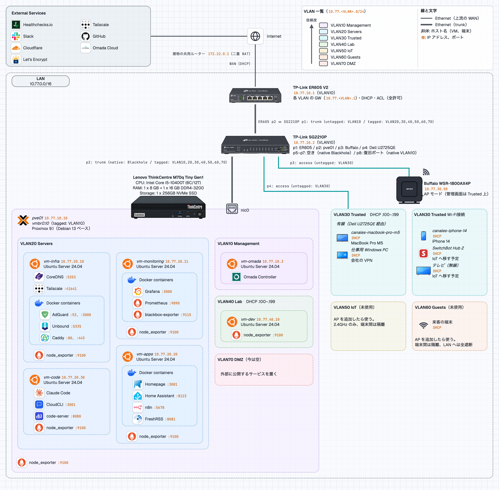
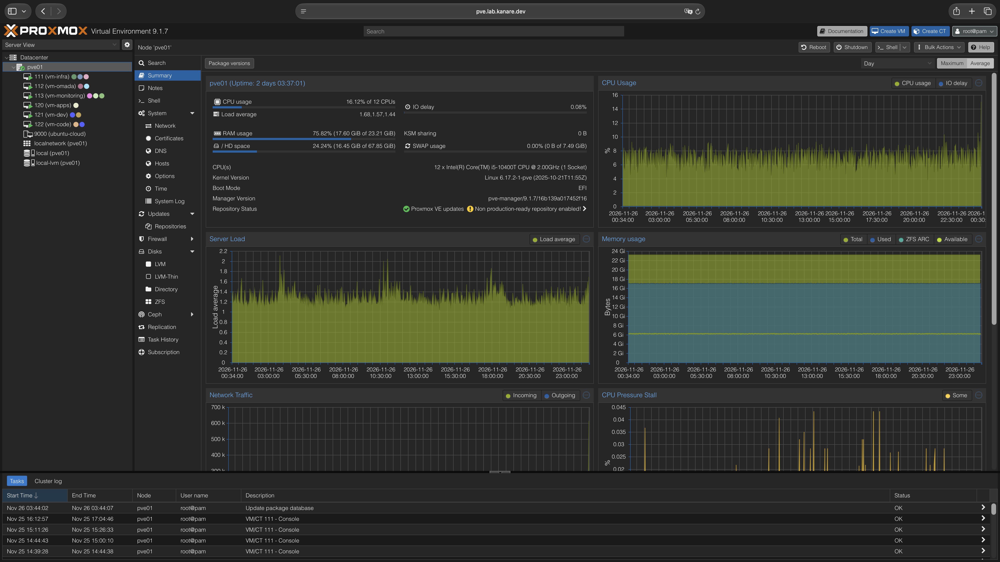
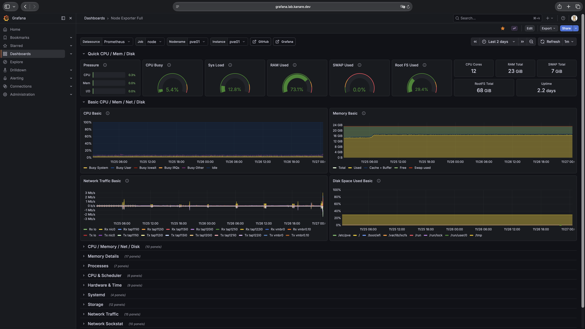
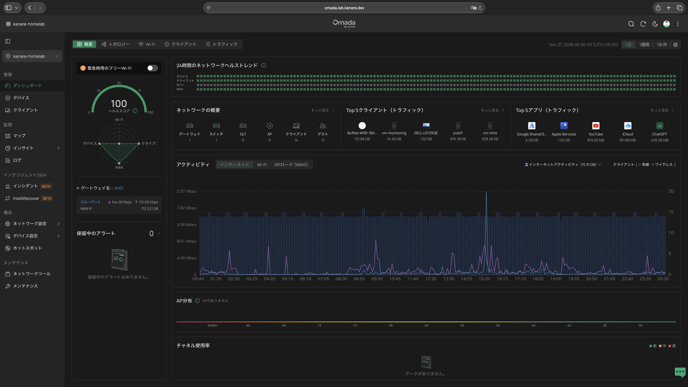
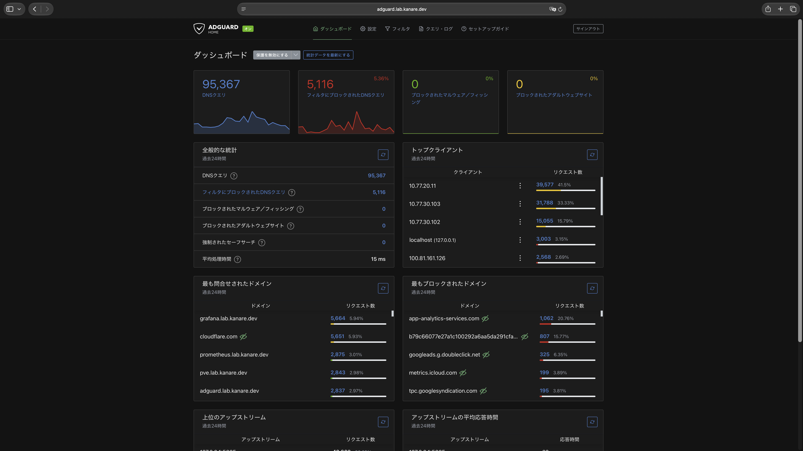

<p align="center">
  <picture>
    <source media="(prefers-color-scheme: dark)" srcset="assets/logo/logo-stack-dark.svg">
    
  </picture>
</p>

<p align="center">
  Proxmox 上の homelab を、Terraform、Ansible、Docker Compose で、再現できるように運用している。<br>
  24GB RAM の ThinkCentre Tiny 1 台の上で、DNS、リバースプロキシ、監視、リモート開発環境を常時動かしている。
</p>

<p align="center">
  <a href="https://github.com/kanare-dev/homelab/actions/workflows/lint.yml"></a>
  <a href="https://github.com/kanare-dev/homelab/commits/main"></a>
  <a href="https://www.proxmox.com/"></a>
  <a href="https://www.terraform.io/"></a>
  <a href="https://www.ansible.com/"></a>
</p>

<p align="center">
  <a href="#architecture">Architecture</a> ·
  <a href="docs/README.md">Documents</a> ·
  <a href="docs/adr/README.md">ADR</a> ·
  <a href="docs/operations/roadmap/README.md">Roadmap</a> ·
  <a href="docs/operations/runbooks/README.md">Runbook</a>
</p>

<p align="center">
  <picture>
    <source media="(prefers-color-scheme: dark)" srcset="docs/diagrams/as-is-diagram/as-is-diagram-dark.png">
    
  </picture>
</p>

## Principles

- **Reproducibility**: 構成をコードで管理し、いつでも同じ環境を再構築できる
- **Observability**: Prometheus と Grafana で VM やサービスの状態を継続的に可視化し、異常は Slack に通知する
- **Document-Driven**: このリポジトリのドキュメントを読めば、全体の構成、設計の方針、運用の方法が分かる

## Features

- **3 層の DNS**: AdGuard Home が広告などをフィルタリングし、`lab.kanare.dev` の問い合わせは CoreDNS に、それ以外は Unbound に渡す。Unbound はルートから再帰解決するので、1.1.1.1 などの外部リゾルバに依存しない（[DNS 構成](docs/architecture/lld/network/dns.md)）。
- **正規の TLS 証明書**: Caddy が Cloudflare DNS-01 で Let's Encrypt の証明書を取得する。LAN の中でも、警告なしで HTTPS にアクセスできる（[リバースプロキシと TLS](docs/architecture/lld/network/reverse-proxy-tls.md)）。
- **二重 NAT でも外出先から接続**: Tailscale を subnet router として動かし、split DNS で `lab.kanare.dev` を引く（[ネットワーク](docs/architecture/hld/05-network.md)）。
- **機密情報の管理**: SOPS + age で暗号化して Git に置く。CI では、gitleaks で秘密の混入を、別の検査で暗号化漏れを調べる（[セキュリティ](docs/architecture/hld/06-security.md)）。
- **可観測性**: Prometheus と Alertmanager が、容量の枯渇、VM の停止、OOM などを検知して Slack に通知する（[監視・アラート](docs/architecture/lld/platform/monitoring.md)）。

## Architecture

上の図は、現状（As-Is）の構成を表している。最終形（To-Be）は [to-be の構成図](docs/diagrams/to-be-diagram/to-be-diagram.png)に、配線は[物理構成図](docs/diagrams/physical-diagram/physical-diagram.png)に載せている。詳しくは[システム構成・環境](docs/architecture/hld/01-system.md)を参照。

| ホスト名 | VMID | IP | 状態 | 役割 | 主なサービス |
| --- | --- | --- | --- | --- | --- |
| `rtr01` | — | `10.77.10.1` | 常時起動 | ルータ | — |
| `sw01` | — | `10.77.10.2` | 常時起動 | マネージドスイッチ | — |
| `pve01` | — | `10.77.10.10` | 常時起動 | ハイパーバイザ | Proxmox VE |
| `vm-infra` | `111` | `10.77.20.10` | 常時起動 | インフラ基盤 | AdGuard Home, Unbound, CoreDNS, Caddy, Tailscale |
| `vm-monitoring` | `113` | `10.77.20.11` | 常時起動 | 監視 | Prometheus, Alertmanager, Grafana, blackbox-exporter |
| `vm-apps` | `120` | `10.77.20.20` | 常時起動 | アプリ | Homepage, Home Assistant, n8n, FreshRSS |
| `vm-omada` | `112` | `10.77.10.3` | 常時起動 | ネットワーク機器の管理 | Omada コントローラー |
| `vm-code` | `122` | `10.77.20.30` | 常時起動 | 常用リモート開発 | Claude Code, CloudCLI, code-server |
| `vm-dev` | `121` | `10.77.40.10` | 任意起動 | 開発・実験 | playground |

ハードウェアは Lenovo ThinkCentre M70q Tiny（i5-10400T / 24GB RAM / 256GB NVMe）。メモリの配分は [性能・拡張性](docs/architecture/hld/04-performance.md) を参照。

## Screenshots

| Proxmox VE — VM 稼働状況 | Grafana — Node Exporter ダッシュボード |
| --- | --- |
|  |  |
| **Omada コントローラー — ネットワークの概要** | **AdGuard Home — DNS フィルタリング** |
|  |  |

## Tech Stack

| レイヤ | 採用技術 | 用途 |
| --- | --- | --- |
| ハイパーバイザ | Proxmox VE | VM の作成・実行・管理 |
| IaC | Terraform | Proxmox 上の VM プロビジョニング |
| 構成管理 | Ansible | OS 初期設定、Docker、node_exporter、監視基盤のデプロイ |
| コンテナ実行 | Docker Compose | Prometheus、Grafana、reverse proxy、Homepage の起動 |
| 監視 | Prometheus, Alertmanager, Grafana, node_exporter | VM / ホストのメトリクス収集と可視化 |
| ネットワーク | AdGuard Home, Unbound, CoreDNS, Caddy, Tailscale | DNS フィルタリング・フル再帰解決・内部権威 DNS、reverse proxy、VPN（サブネットルーター） |
| TLS 証明書 | Let's Encrypt + Cloudflare DNS-01 | LAN 内サービスへの正規証明書発行 |
| 秘密情報管理 | SOPS + age | 機密情報を暗号化して Git で管理 |

## Documents

| ディレクトリ | 区分 | 内容 |
| --- | --- | --- |
| [docs/architecture/hld/](docs/architecture/hld/README.md) | 基本設計 | [システム構成・環境](docs/architecture/hld/01-system.md)、[信頼性](docs/architecture/hld/02-reliability.md)、[運用・保守](docs/architecture/hld/03-operations.md)、[性能・拡張性](docs/architecture/hld/04-performance.md)、[ネットワーク](docs/architecture/hld/05-network.md)、[セキュリティ](docs/architecture/hld/06-security.md) |
| [docs/architecture/lld/](docs/architecture/lld/README.md) | 詳細設計 | [IP アドレス一覧](docs/architecture/lld/network/ip-addresses.md)、[DNS](docs/architecture/lld/network/dns.md)、[リバースプロキシと TLS](docs/architecture/lld/network/reverse-proxy-tls.md)、[監視・アラート](docs/architecture/lld/platform/monitoring.md)、[Home Assistant](docs/architecture/lld/apps/home-assistant.md)、[Homepage](docs/architecture/lld/apps/homepage.md)、[n8n](docs/architecture/lld/apps/n8n.md)、[FreshRSS](docs/architecture/lld/apps/freshrss.md)、[CI/CD](docs/architecture/lld/dev/cicd.md) |
| [docs/operations/](docs/operations/runbooks/README.md) | 運用 | [Runbook](docs/operations/runbooks/README.md)、[バックアップの手順](docs/operations/runbooks/06-backup-restore.md)、[障害記録](docs/operations/incidents/README.md)、[ロードマップ](docs/operations/roadmap/README.md) |
| [docs/adr/](docs/adr/README.md) | ADR | 設計判断の記録 |

## Security

- 秘密情報は SOPS + age で暗号化して、Git で管理する。平文のシークレットはコミットしない。
- SSH は鍵認証だけを許可し、ファイアウォール（`ufw`）では、必要なポートだけを開ける。
- LAN の内側でも、Caddy を使って HTTPS で通信する。

詳細は [セキュリティ](docs/architecture/hld/06-security.md) を参照。

## Quick Start

前提: [Terraform](https://www.terraform.io/) 1.5 以上、[Ansible](https://docs.ansible.com/) 2.15 以上、Proxmox VE 9.x が稼働済みで、対象 VM に SSH 鍵認証で入れること。Proxmox の API トークンを、事前に発行しておく（[`terraform/proxmox/README.md`](terraform/proxmox/README.md)）。

```bash
git clone https://github.com/kanare-dev/homelab.git && cd homelab

# 1. VM をプロビジョニング（VM の定義は terraform.tfvars。秘密は SOPS: docs/operations/runbooks/03-secrets.md）
cd terraform/proxmox
sops secrets.sops.yml        # proxmox_api_token_secret を設定
terraform init && terraform apply

# 2. VM を構成
cd ../../ansible
ansible-playbook playbooks/site.yml

# 3. 動作確認
dig @10.77.20.10 grafana.lab.kanare.dev
```

詳しい手順は、各ディレクトリの README（[`terraform/proxmox/`](terraform/proxmox/README.md)、[`ansible/`](ansible/README.md)、[`docker/compose/`](docker/compose/README.md)）と、[Runbook](docs/operations/runbooks/README.md) にある。ディレクトリの全体像は、[リポジトリ構成](docs/README.md#リポジトリ構成)。

## License

コードと文書は [MIT](LICENSE)。次のものは、対象外である。

- **ロゴ**（`assets/logo/`）: すべての権利は、作者にある。このリポジトリを参考にするときは、自分のものとして使わないこと（生成スクリプト `make-logo.py` は、MIT）。
- **第三者の資料**: メーカーの公式資料の引用や要約（`docs/architecture/lld/hardware/<型番>.md` など）は、それぞれの権利者のもの。
- **3D モデル**: `docs/architecture/lld/hardware/future/rack-10inch/` に出所を書いた 3D モデルは、他の作者のもの（別のライセンス）で、このリポジトリには含めていない。

<p align="center">
  <sub>kanare’s homelab · <a href="https://github.com/kanare-dev">kanare-dev</a></sub>
</p>
