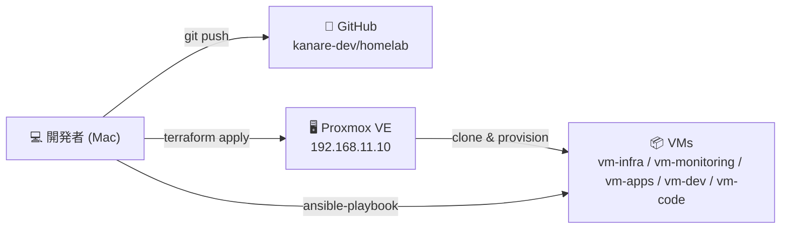
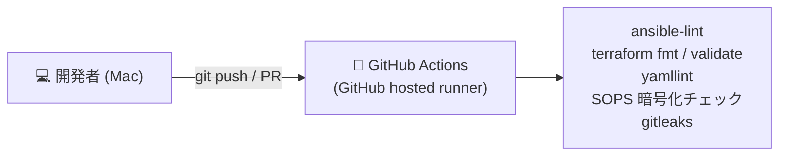

# CI/CD 構成

Terraform + Ansible による infrastructure as code の全体フローと、CI の方針をまとめる。

## 現在のフロー（手動）

```ascii
開発者 (Mac)
  │
  ├─ terraform apply ──→ Proxmox API ──→ VM 作成 / 更新
  │
  ├─ ansible-playbook ──→ SSH ──→ VM 設定・サービスデプロイ
  │
  └─ git push ──→ GitHub (kanare-dev/homelab)
```



外出先からは Tailscale（vm-infra のサブネットルーター）経由で LAN に入り、同じ手順で操作する。

## 方針

| 対象 | 自動化 | 理由 |
| --- | --- | --- |
| lint・静的チェック | する（GitHub hosted runner） | LAN への接続も秘密情報も不要。リポジトリが公開なので、平文シークレットの混入を CI で止められる |
| `terraform plan` | しない | state と Proxmox API に届く runner が必要。運用者が一人で VM 数も少なく、手元で足りる |
| `terraform apply` | しない | 意図しない VM 削除のリスクがある |
| `ansible-playbook` | しない | LAN 内 runner に SSH 鍵を置くことになり、公開リポジトリでは fork PR 経由の実行リスクを抱える |

デプロイ系の自動化（plan / apply / playbook）は、Proxmox API トークンや SSH 鍵を持つ runner が必要になる。
得られる効果に対してリスクが大きいため、手動運用を続ける。

## CI（lint）



GitHub hosted runner だけで動かし、LAN にも Secrets にも触れない。

| チェック | 内容 |
| --- | --- |
| ansible-lint | `make lint` と同じ（`ansible/playbooks/`） |
| terraform fmt / validate | `terraform fmt -check` と `terraform init -backend=false` + `terraform validate` |
| yamllint | Ansible・Docker Compose・各種 YAML の構文 |
| SOPS 暗号化チェック | `*.sops.yml` が暗号化済みであること（`sops:` メタデータの存在）。復号はしない（age 秘密鍵を CI に置かない） |
| gitleaks | 平文シークレットの混入検知 |

`make secrets-check` は復号して検証するため、CI では使えない。CI では暗号化されていることだけを確認する。
