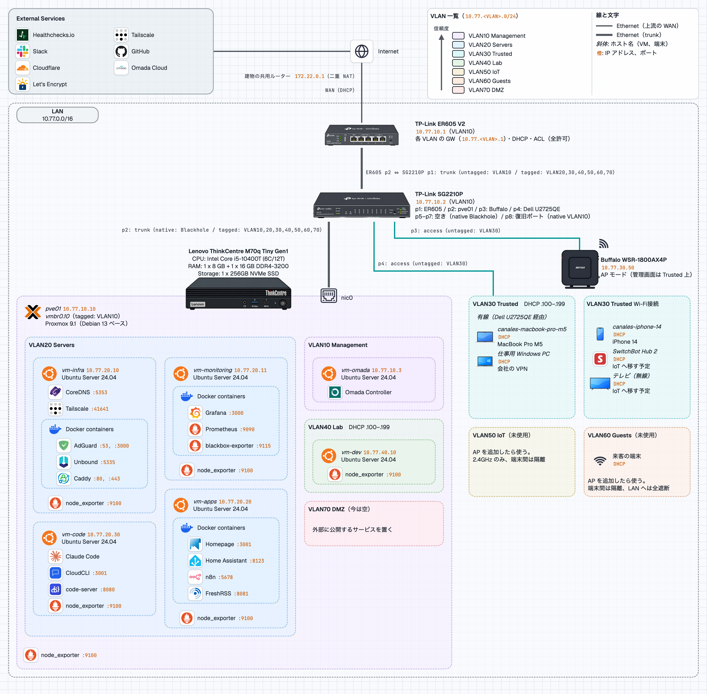

# 第１章 システム概要

- この文書では、homelab の全体像として、最新の構成図、目的、構成にした理由、前提と制約をまとめる。
- 構成要素の詳細は、[第２章 インフラ構成](02-infrastructure.md)、[第３章 ネットワーク設計](03-network.md)、[第４章 可用性・信頼性](04-reliability.md)を参照のこと。

## 構成図

現状の構成は、現状（as-is）の構成図を正とする。図は常に実機の状態を表し、構成を変えたときに更新する（更新の手順は `docs/diagrams/README.md` を参照のこと）。

  <picture>
    <source media="(prefers-color-scheme: dark)" srcset="../diagrams/as-is-diagram/as-is-diagram-dark.png">
    
  </picture>

この図は現状（as-is。段階 3 の後）を表している。詳しくは[現状の構成図](../diagrams/README.md#現状の構成図as-is-diagram)を参照してほしい。最終形（to-be）の図は、[to-be の構成図](../diagrams/README.md#to-be-の構成図-vlan-化のあとto-be-diagram)にある。

- ER605（`10.77.10.1`）は、既定のネットワーク Management（VLAN10）に属する。
- `vm-infra`、`vm-monitoring`、`vm-apps`、`vm-code` は、常時起動を前提とし、 VLAN20（Servers）に所属させる。
- `vm-dev` は検証用のVMであるため、 Lab（VLAN40、`10.77.40.10`）に所属させる。
- p2 と空きポートの native は、どこにも繋がない `Blackhole`（VLAN 999）とする（[ADR-0032](../adr/0032-merge-default-network-into-management-vlan10.md)）。

`vm-monitoring` では Prometheus に加えて blackbox-exporter が、Caddy 経由の HTTPS と AdGuard の名前解決を外形監視し、ping（ICMP）でインターネット回線の断・遅延も見る（[監視・アラート](lld/platform/monitoring.md)）。

外部サービス（Healthchecks.io、Slack、Cloudflare、Let's Encrypt、Tailscale、GitHub、Omada Cloud）は、いずれも LAN から外向きに接続するだけである。外部から LAN に入る経路は、Tailscale と、Omada Cloud 経由で開く Omada コントローラーの管理画面の 2 つだけである（[外部接続](03-network.md#外部サービスへの依存)）。

`node_exporter` は全 VM（`vm-infra` / `vm-monitoring` / `vm-apps` / `vm-dev` / `vm-code` / `vm-omada`）と Proxmox ホストに常駐し、`vm-monitoring` の Prometheus がまとめてスクレイプする。

`vm-omada` の Omada コントローラーは、ER605・SG2210P を管理する（2026-11-03 に稼働。2026-11-06 に、ER605・SG2210P を採用した）。Buffalo は AP モードで動かしており、コントローラーの管理対象に入れていない。コントローラーが止まっても、機器は設定を保持したまま動き続ける。

## 目的と位置づけ

- 個人の検証と日常の利用のための環境である。商用サービスではないので、SLA は持たない（[可用性](04-reliability.md)）。
- 構成のすべてを Terraform、Ansible、Docker Compose でコード化し、いつでも同じ環境を再構築できるようにしておく。
- 環境は 1 つだけで、本番と開発を分けていない。破壊を伴う検証は `vm-dev` で行い、他の VM を壊さないようにする。

## この構成にした理由

最小構成から始めて、必要に応じて段階的に拡張する方針をとった。

| 観点 | 判断 |
| --- | --- |
| メモリ余裕 | 24GB に増設済み。重めのワークロードや追加 VM を検討できる（[性能・拡張性](02-infrastructure.md)） |
| 優先順位 | まず DNS、リバースプロキシ、監視をコード化して再現性を固める |
| 学習効率 | `vm-dev` があると、設定や playbook を安全に壊して試せる |
| 拡張性 | `vm-apps` に Home Assistant、n8n、FreshRSS などを追加しやすい |

## 前提と制約

| 項目 | 内容 |
| --- | --- |
| 単一ホスト | 全 VM が 1 台の Proxmox ホストと 1 つの NVMe に載る。冗長化はしない |
| 二重 NAT | 外からポート開放ができない。外部からの到達は Tailscale に限る（[外部接続](03-network.md)） |
| ストレージ | `local-lvm`（LVM-thin、約 155GiB）に全 VM のディスクを置く。過剰割当（約 1.4 倍）で運用している（[性能・拡張性](02-infrastructure.md)） |
| ドメイン | `lab.kanare.dev`（内部ゾーンは CoreDNS、証明書は Let's Encrypt） |
| タイムゾーン・NTP | `Asia/Tokyo`、`ntp.nict.jp` / `time.google.com` |
| 管理操作 | Mac から SSH / Terraform / Ansible で行う。自動デプロイはしない |
