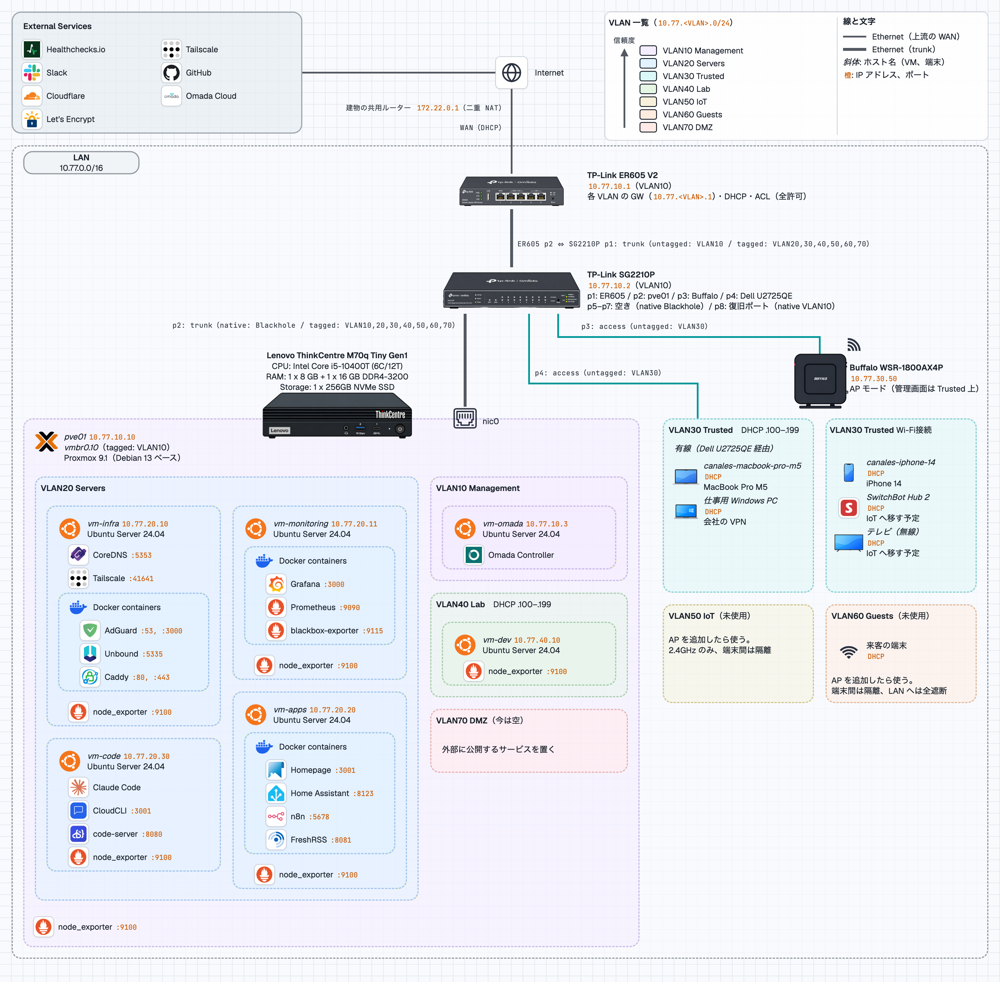

# 第1章 システム構成・環境

この章では、homelab の全体像として、現状の構成図、目的、この構成にした理由、前提と制約を示す。続けて、物理構成、論理構成、ソフトウェア構成を説明する。信頼性、運用・保守、性能・拡張性、ネットワーク、セキュリティは、[第2章](02-reliability.md)から[第6章](06-security.md)で扱う。サービスごとの詳細は[詳細設計](../lld/README.md)にある。

## 構成図

現状の構成は、現状（as-is）の構成図を正とする。図は常に実機の状態を表し、構成を変えたときに更新する（更新の手順は `docs/diagrams/README.md` を参照のこと）。

  <picture>
    <source media="(prefers-color-scheme: dark)" srcset="../../diagrams/as-is-diagram/as-is-diagram-dark.png">
    
  </picture>

この図は現状（as-is）を表している。詳しくは[現状の構成図](../../diagrams/README.md#現状の構成図as-is-diagram)を参照してほしい。最終形（to-be）の図は、[to-be の構成図](../../diagrams/README.md#to-be-の構成図-vlan-化のあとto-be-diagram)にある。

- ER605（`10.77.10.1`）は、既定のネットワーク Management（VLAN10）に属する。
- `vm-infra`、`vm-monitoring`、`vm-apps`、`vm-code` は、常時起動を前提とし、 VLAN20（Servers）に所属させる。
- `vm-dev` は検証用のVMであるため、 Lab（VLAN40、`10.77.40.10`）に所属させる。
- p2 と空きポートの native は、どこにも繋がない `Blackhole`（VLAN 999）とする（[ADR-0032](../../adr/0032-merge-default-network-into-management-vlan10.md)）。

`vm-monitoring` では Prometheus に加えて blackbox-exporter が、Caddy 経由の HTTPS と AdGuard の名前解決を外形監視し、ping（ICMP）でインターネット回線の断・遅延も見る（[監視・アラート](../lld/platform/monitoring.md)）。AdGuard Home の統計（クエリ数、ブロック率、上流の応答時間）は、adguard-exporter が Caddy 経由の HTTPS で読み、Grafana で見る（[ADR-0038](../../adr/0038-adguard-stats-via-adguard-exporter.md)）。Omada が管理する機器・ポート・クライアントの状態も、omada-exporter が Caddy 経由の HTTPS でコントローラーの API を読み、Grafana で見る（[ADR-0039](../../adr/0039-omada-metrics-via-omada-exporter.md)）。

外部サービス（Healthchecks.io、Slack、Cloudflare、Let's Encrypt、Tailscale、GitHub、Omada Cloud）は、いずれも LAN から外向きに接続するだけである。外部から LAN に入る経路は、Tailscale と、Omada Cloud 経由で開く Omada コントローラーの管理画面の 2 つだけである（[外部接続](05-network.md#外部サービスへの依存)）。

`node_exporter` は全 VM（`vm-infra` / `vm-monitoring` / `vm-apps` / `vm-dev` / `vm-code` / `vm-omada`）と Proxmox ホストに常駐し、`vm-monitoring` の Prometheus がまとめてスクレイプする。

`vm-omada` の Omada コントローラーは、ER605・SG2210P を管理する（2026-11-03 に稼働。2026-11-06 に、ER605・SG2210P を採用した）。Buffalo は AP モードで動かしており、コントローラーの管理対象に入れていない。コントローラーが止まっても、機器は設定を保持したまま動き続ける。

## 目的と位置づけ

- 個人の検証と日常の利用のための環境である。商用サービスではないので、SLA は持たない（[可用性](02-reliability.md)）。
- 構成のすべてを Terraform、Ansible、Docker Compose でコード化し、いつでも同じ環境を再構築できるようにしておく。
- 環境は 1 つだけで、本番と開発を分けていない。破壊を伴う検証は `vm-dev` で行い、他の VM を壊さないようにする。

## この構成にした理由

最小構成から始めて、必要に応じて段階的に拡張する方針をとった。

| 観点 | 判断 |
| --- | --- |
| メモリ余裕 | 24GB に増設済み。重めのワークロードや追加 VM を検討できる（[性能・拡張性](04-performance.md)） |
| 優先順位 | まず DNS、リバースプロキシ、監視をコード化して再現性を固める |
| 学習効率 | `vm-dev` があると、設定や playbook を安全に壊して試せる |
| 拡張性 | `vm-apps` に Home Assistant、n8n、FreshRSS などを追加しやすい |

## 前提と制約

| 項目 | 内容 |
| --- | --- |
| 単一ホスト | 全 VM が 1 台の Proxmox ホストと 1 つの NVMe に載る。冗長化はしない |
| 二重 NAT | 外からポート開放ができない。外部からの到達は Tailscale に限る（[外部接続](05-network.md)） |
| ストレージ | `local-lvm`（LVM-thin、約 155GiB）に全 VM のディスクを置く。過剰割当（約 1.4 倍）で運用している（[性能・拡張性](04-performance.md)） |
| ドメイン | `lab.kanare.dev`（内部ゾーンは CoreDNS、証明書は Let's Encrypt） |
| タイムゾーン・NTP | `Asia/Tokyo`、`ntp.nict.jp` / `time.google.com` |
| 管理操作 | Mac から SSH / Terraform / Ansible で行う。自動デプロイはしない |

## 物理構成

| 機器 | モデル | スペック | IP | 備考 |
| --- | --- | --- | --- | --- |
| サーバー | Lenovo ThinkCentre M70q Tiny | i5-10400T / 24GB RAM / 256GB NVMe | `10.77.10.10`（VLAN10） | Proxmox VE ホスト。物理 NIC は 1 つ |
| ルーター | TP-Link ER605 V2 | — | `10.77.10.1`（既定のネットワーク。Management、VLAN10） | 集合住宅の共用ルーターの下に置く（二重 NAT）。Omada コントローラー（`vm-omada`）が管理する |
| スイッチ | TP-Link SG2210P | — | `10.77.10.2`（固定。Management、VLAN10） | PoE+ スイッチ。ER605 の p2 に繋ぎ、Proxmox・Buffalo・ディスプレイを収める。Omada コントローラーが管理する |
| AP | Buffalo WSR-1800AX4P | — | `10.77.30.50`（固定。Trusted） | AP（ブリッジ）モード。Wi-Fi の入口だけを担う（Omada の AP を導入したら退役する予定） |

- 電源に UPS はない。ホスト 1 台にすべての VM が載っているので、ここが単一障害点になる（[可用性](02-reliability.md)）。
- ネットワークの分割（VLAN）は、[第5章 ネットワーク](05-network.md)で説明している。

## 論理構成

Proxmox VE 上に Terraform で VM を作り、Ansible で設定し、各 VM で Docker Compose を動かす。

| 名前 | VMID | IP | vCPU | RAM | ディスク | 起動 | 役割 | 主なサービス |
| --- | --- | --- | ---: | ---: | ---: | --- | --- | --- |
| `vm-infra` | 111 | `10.77.20.10`（VLAN20） | 2 | 1.5GB | 20G | 自動（順序 1） | インフラ基盤 | AdGuard Home, Unbound, CoreDNS, Caddy, Tailscale |
| `vm-omada` | 112 | `10.77.10.3`（Management、VLAN10。2026-11-19 から） | 2 | 4GB | 20G | 自動（順序 6） | ネットワーク機器の管理 | Omada コントローラー（Docker。ER605・SG2210P を管理） |
| `vm-monitoring` | 113 | `10.77.20.11`（VLAN20） | 2 | 2GB | 40G | 自動（順序 2） | 監視 | Prometheus, Alertmanager, Grafana, blackbox-exporter, adguard-exporter（[ADR-0038](../../adr/0038-adguard-stats-via-adguard-exporter.md)）, omada-exporter（[ADR-0039](../../adr/0039-omada-metrics-via-omada-exporter.md)） |
| `vm-apps` | 120 | `10.77.20.20`（VLAN20） | 2 | 4GB | 40G | 自動（順序 3） | アプリ | Homepage, Home Assistant, n8n, FreshRSS |
| `vm-dev` | 121 | `10.77.40.10`（VLAN40） | 2 | 1GB | 10G | 手動 | 破壊検証 | playground |
| `vm-code` | 122 | `10.77.20.30`（VLAN20） | 2 | 4GB | 30G | 自動（順序 5） | 常用リモート開発 | Claude Code, CloudCLI, code-server, gh, git, mosh, moshi-hook |
| `ubuntu-cloud` | 9000 | — | — | — | — | — | VM テンプレート | cloud-init 付き Ubuntu |

VM の定義は `terraform/proxmox/terraform.tfvars` が正である。IP アドレスの一覧（現在と移行後）は [IP アドレス一覧](../lld/network/ip-addresses.md)にあり、起動順序と待機秒数は [運用 Runbook](../../operations/runbooks/01-vm-startup-shutdown.md#vm-自動起動停止)に書いている。

## ソフトウェア構成

| レイヤ | 採用技術 | 管理場所 |
| --- | --- | --- |
| ハイパーバイザ | Proxmox VE 9.x（Debian 13 ベース） | `ansible/roles/proxmox/`（Web UI の警告除去、収集スクリプト） |
| VM プロビジョニング | Terraform（`telmate/proxmox` 3.0.2-rc07） | `terraform/proxmox/` |
| OS 設定 | Ansible（Ubuntu Server 24.04 LTS。[ADR 0021](../../adr/0021-ubuntu-lts-for-vms.md)） | `ansible/roles/common/` ほか |
| コンテナ | Docker Compose | `docker/compose/<stack>/` → VM 上の `/opt/<stack>/` |
| 監視 | Prometheus, Alertmanager, Grafana, blackbox-exporter, node_exporter | [監視・アラート](../lld/platform/monitoring.md) |
| 名前解決 | AdGuard Home → CoreDNS / Unbound | [DNS 構成](../lld/network/dns.md) |
| リバースプロキシ・TLS | Caddy + Let's Encrypt（Cloudflare DNS-01） | [運用 Runbook](../../operations/runbooks/04-tls-certificates.md#lan-内-tls) |
| 秘密情報 | SOPS + age | [セキュリティ](06-security.md) |
| CI | GitHub Actions（lint のみ） | [CI/CD](../lld/dev/cicd.md) |
