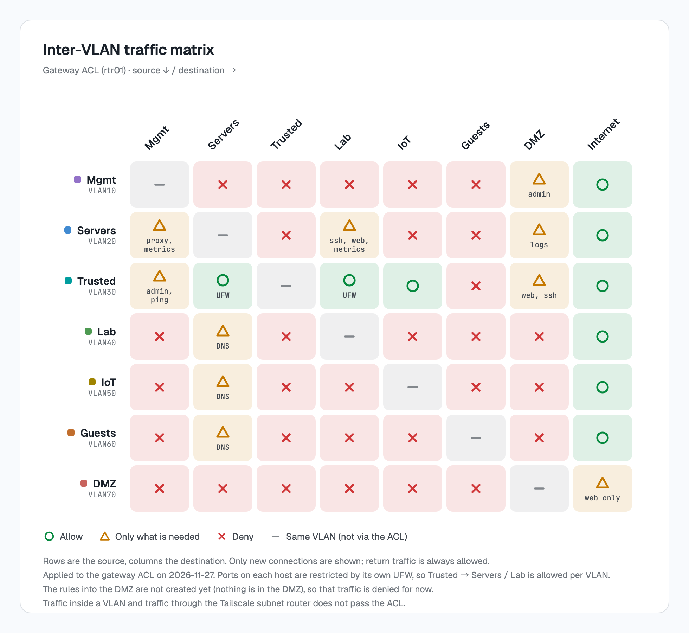

# 第5章 ネットワーク

この章では、ネットワークの設計として、アドレス体系と VLAN による分割、機器の配置、通信ポリシー、外部との接続をまとめる。アドレスや DHCP の具体的な値は [IP アドレス一覧](../lld/network/ip-addresses.md)、ACL の書き方は [ACL の名前と説明の付け方](../lld/network/acl.md)、DNS とリバースプロキシの詳細は [DNS 構成](../lld/network/dns.md)と[リバースプロキシと TLS](../lld/network/reverse-proxy-tls.md)にある。まだ決まっていない項目は、[Omada 導入・VLAN 化のロードマップ](../../operations/roadmap/04-network-omada-vlan.md)で扱う。

## 目的

- IoT・ゲスト・日常端末（Trusted）・サーバー・検証用（Lab）・管理機器・DMZ（外部に触れるもの）を分け、侵害されたときの影響範囲を狭める。
- 管理画面（ルーター、スイッチ、AP、Proxmox、Omada コントローラー）を、管理用ネットワークだけに閉じる。
- VLAN ID とアドレスの第 3 オクテットをそろえ、アドレスを見ただけで、所属する VLAN が分かるようにする。

## 前提と制約

- Proxmox ホスト（Lenovo ThinkCentre M70q Tiny）の物理 NIC は 1 つである。複数の VLAN に VM を置くため、スイッチのポートを trunk にし、Proxmox のブリッジを VLAN-aware にしている。
- DNS（AdGuard Home）、Caddy、Tailscale は `vm-infra` 1 台に載っている。ここが止まると全 VLAN の名前解決が止まる（INC-2026-10-22）。この構造は VLAN に分けても変わらないので、VLAN を増やすほど `vm-infra` への依存が目立つ。
- 設定の大半は Omada コントローラーの中に入り、今は Git で管理していない。バックアップが唯一の記録になる。Open API とコミュニティ製の Terraform プロバイダーでコード化できる可能性がある（未検証。[バックログ](../../operations/roadmap/01-backlog.md)）。
- 現在は二重 NAT 環境である（集合住宅で、建物の共用ルーターの下に ER605 を置いている）。外からポート開放ができないため、外出先からのアクセスは Tailscale に頼っている。数年のうちに引っ越す予定があり、新居の上流ネットワークは分からない。
- 家に AirPlay と Google Cast（Google TV）に対応したテレビがある。現在は有線で接続している。VLAN をまたぐと機器の発見（mDNS）が届かなくなるため、設計に織り込む（後述）。

## アドレス体系と VLAN

IP アドレスの一覧（アドレスの範囲、VLAN、ホスト、FQDN の宛先）は、[IP アドレス一覧](../lld/network/ip-addresses.md)にまとめている。

### アドレス体系: `10.77.<VLAN>.0/24`

この判断は [ADR-0015](../../adr/0015-vlan-address-scheme-10-77.md) に記録している（[ADR-0003](../../adr/0003-vlan-address-scheme.md) を置き換えた）。VLAN の構成と ID の振り直しは、[ADR-0022](../../adr/0022-vlan-set-and-ids.md) に記録している。

**決定**: 各 VLAN を `10.77.<VLAN ID>.0/24` にする（例: Servers は `10.77.20.0/24`）。第 2 オクテット `77` は家に固有の値で固定し、第 3 オクテットを VLAN ID に揃える。家全体は `10.77.0.0/16` に収まる。

**根拠**:

- 外出先から Tailscale で自宅の subnet route に繋ぐとき、手元のネットワークと自宅のサブネットが同じアドレス帯だと、端末は「手元にある」と判断して自宅に送らない。繋がったり繋がらなかったりする、原因の分かりにくい障害になる。
- 家庭用ルーターの初期値は `192.168.x.x` が大半で、職場や他の VPN では `10.0`、`10.1`、`10.10`、`10.20`、`10.100` なども使われやすい。第 2 オクテットを珍しい値（77）に固定すれば、被るのは相手が `10.77.0.0/16` を使うときだけになる。
- 家全体を `10.77.0.0/16` の 1 つの範囲で扱えるので、ファイアウォールや経路を書きやすい。

**残るリスク**: `10.77` が、外出先（職場・実家など）や引っ越し先の上流で使われていることがある。引っ越し先では、最初に確認する。

### VLAN の構成

VLAN の ID は、信頼度の高い順（内側から外側）に振り、外部に触れるもの（Guests、DMZ）を末尾に置く（[ADR-0022](../../adr/0022-vlan-set-and-ids.md)）。サブネットは `10.77.<VLAN ID>.0/24`、ゲートウェイは各 VLAN の `.1` である。アドレス帯の区切り、DHCP の決まり、ホストごとの固定アドレスは、[IP アドレス一覧](../lld/network/ip-addresses.md)にある。

| VLAN | 名前 | 置くもの |
| --- | --- | --- |
| 10 | Management | ルーター、Managed Switch、AP、Omada コントローラー、Proxmox ホスト |
| 20 | Servers | 常時稼働のサーバー（`vm-infra`、`vm-monitoring`、`vm-apps`、`vm-code`） |
| 30 | Trusted | 母艦 PC、スマホ、タブレットなどの日常端末。Buffalo（AP） |
| 40 | Lab | 一時的な検証用 VM、開発環境（`vm-dev`） |
| 50 | IoT | テレビ（AirPlay / Google TV）などのデバイス |
| 60 | Guests | 来客の端末 |
| 70 | DMZ | ハニーポット、公開用 Web サーバー、`cloudflared`（検討中。[DMZ と外部公開](../../operations/roadmap/07-dmz.md)） |
| 999 | Blackhole | 使わないポートの native。どこにも繋がない（[ADR-0032](../../adr/0032-merge-default-network-into-management-vlan10.md)） |

### WAN 側は設計から切り離す

**決定**: VLAN 設計はルーターの LAN 側だけで完結させ、WAN 側の繋ぎ方に依存させない。

**根拠**: 引っ越しで上流が変わる（共用ルーター、ONU、ホームゲートウェイなど）。LAN 側の VLAN・アドレス・ファイアウォールを上流から独立させておけば、引っ越し時に直すのは新ルーターの WAN 設定だけで済む。Tailscale は外向きの接続だけで成立するので、上流が二重 NAT でも CGNAT でも変わらず使える。

**注意**: ルーターの WAN 側と LAN 側が同じアドレス帯だと、ルーターが正しく動かないことがある。上流が `10.x` 系を配っていると、`10.77.0.0/16` と被りうる。引っ越し先では、最初に、上流から受け取っているアドレス帯を確認する（[ロードマップ 04](../../operations/roadmap/04-network-omada-vlan.md)）。

## ドメイン命名規約

内部 DNS では `lab.kanare.dev` ゾーンを使い、CoreDNS が権威サーバーとして応答する（[DNS 構成](../lld/network/dns.md)）。サービスは `<サービス名>.lab.kanare.dev`、固定 IP を持つホスト（VM、Proxmox ホスト、ネットワーク機器）は `<ホスト名>.lab.kanare.dev` という名前で引く（[ADR-0036](../../adr/0036-a-record-for-every-fixed-ip-host.md)）。

FQDN ごとの宛先（IP とポート）は、[IP アドレス一覧](../lld/network/ip-addresses.md#fqdn-の宛先)にある。

Caddy 経由の FQDN には、証明書を FQDN ごとに取得する（[リバースプロキシと TLS](../lld/network/reverse-proxy-tls.md)）。

## SSID の命名規約

Wi-Fi の SSID は、共通の `Onda` に、ハイフンと接尾辞を続けて名付ける（[ADR-0042](../../adr/0042-ssid-names-by-vlan.md)、[ADR-0045](../../adr/0045-ssid-onda-transition-and-no-iot-isolation.md)）。接尾辞のない `Onda` は Trusted に入る。接尾辞には、その SSID が入る VLAN の英語の名前を使う。ただし、Guests は来客が読む名前なので、単数の `Guest` にする。名前には ASCII の英字、数字、ハイフンだけを使い、空白は入れず、32 バイト以内にする。Management、Servers、DMZ の SSID は出さない。

Trusted は、WPA2 と WPA3 を兼ねる `Onda` の 1 つだけにする。Omada では、2.4GHz と 5GHz で WPA3 だけのモードを選べないため、以前の WPA3 用の `Onda-Forte` はやめた（ADR-0045）。

| SSID | VLAN | WPA モード | 状態 |
| --- | --- | --- | --- |
| `Onda` | 30 Trusted | `WPA2-PSK/WPA3-SAE`（PMF は対応） | Buffalo では WPA2 で使用中。AP（EAP653）の導入時に移す |
| `Onda-IoT` | 50 IoT | `WPA2-PSK`（2.4GHz のみ。端末どうしは分離しない） | AP（EAP653）の導入時に作る |
| `Onda-Guest` | 60 Guests | `WPA2-PSK` | AP（EAP653）の導入時に作る。端末どうしの分離（ゲストネットワーク）は、実機で試してから決める |
| `Onda-Lab` | 40 Lab | 未定 | 無線で繋ぐ検証機が出たときに作る |

パスフレーズは SSID ごとに変え、台帳に記録する。

## 配置の方針

- **Proxmox ホストは Management に置く。** 管理面（`:8006`）が VM と同じネットワークに載らない。ホストの IP は、タグ付きの `vmbr0.10`（`10.77.10.10/24`）に付ける。`vmbr0` は VLAN-aware で、IP を持たない。手順は[手順書 24](../../operations/runbooks/24-pve-move-to-vmbr0-10.md)にある。
- **VM は VLAN タグ付きで割り当てる。** Proxmox のブリッジ（`vmbr0`）を VLAN-aware にし、VM ごとに VLAN ID を指定する。Terraform の VM モジュールに `vlan_id` を持たせる。
- **スイッチの Proxmox 向けポートは trunk で、全 VLAN をタグ付きにする**（判断の記録: [ADR-0023](../../adr/0023-proxmox-trunk-all-tagged.md)）。Management・Servers・Trusted・Lab・IoT・Guests・DMZ を tagged で通し、native（untagged）は、どこにも繋がない `Blackhole`（VLAN 999）にする（2026-11-20 から。それまでは未使用の VLAN1）。**タグ付きに Management を必ず含める**（含めないと、VLAN10 が untagged になり、Proxmox・`vm-omada` に届かない）。全 VM は VLAN ID を必ず指定する（Management の `vm-omada` も `tag=10`）。タグなしの通信は、どこの VLAN にも入らない。native を `Blackhole` にした判断は [ADR-0032](../../adr/0032-merge-default-network-into-management-vlan10.md) に記録している。
- **Omada コントローラーは Management の VM に置く。** 管理機器と同じ面に置き、Trusted・Servers・Lab から直接触れないようにする。現在は `10.77.10.3`（VLAN10）に置いている（[ADR-0031](../../adr/0031-stage3b-devices-before-controller.md)）。
- **DMZ の VM は、Proxmox の同じブリッジに載せる場合、ホスト侵害のリスクが VLAN 分離だけでは消えない。** Proxmox の管理面を DMZ に出さず、仮想 NIC とブリッジの設定を確認する。DMZ の置き場所は、まず同じホストで検証し、将来は別の機器（小型 PC やラズパイなど）にする（検討中。[ロードマップ 04](../../operations/roadmap/04-network-omada-vlan.md)）。
- **`vm-dev` は Lab、`vm-code` と `vm-apps` は Servers に置く。** 開発環境と一時的な検証用 VM は、常時稼働のサーバーと分け、Lab から他の VLAN へは入れないようにする。`vm-code` は常時稼働にしたいので Servers に置く。他の VM とは性質が違うので、`.30–.39` の「開発・作業用」の帯に置く（番号の整理のためで、隔離ではない。[ADR-0027](../../adr/0027-servers-octet-bands-and-emergency-dns.md)）。
- **テレビは IoT に置く。** ベンダーのクラウドに繋がる機器であり、他の VLAN から隔離したい。ただし AirPlay・Cast の発見のために mDNS の中継が必要（次節）。
- **Wi-Fi は、Buffalo（AP モード）が出す 1 つの SSID だけで、Trusted に入る。** Buffalo は VLAN に対応していないので、IoT と Guests の Wi-Fi は、Omada の AP を導入するまで作れない。AP モードの Buffalo の管理画面は Trusted にあり、実装が簡素な管理画面を Trusted から届く場所に置くことになる。AP を導入するまでの、期間を限った構成として受け入れている（[ロードマップ 04](../../operations/roadmap/04-network-omada-vlan.md)）。

## mDNS（AirPlay / Google Cast）

AirPlay も Google Cast も、機器の発見に mDNS を使う。mDNS の呼びかけは同じ VLAN の中にしか届かないため、Trusted のスマホ・Mac から IoT のテレビが見えなくなる。

**対処**: ルーターまたは AP で mDNS の中継（リフレクター）を有効にし、Trusted と IoT の間でだけ中継する。Omada に該当機能がある（機種とコントローラーのバージョンによる）。実機で動くことは、まだ確かめていない（[ロードマップ 04](../../operations/roadmap/04-network-omada-vlan.md)）。

**関連する通信**:

- Trusted → IoT の新規接続は許可済み（許可表）。AirPlay・Cast の制御・ストリーミングはこの向き。
- AirPlay のミラーリングやローカルメディアのキャスト（テレビが端末からメディアを取りに来る方式）では、テレビ → Trusted の接続が必要になることがある。**既定では IoT → Trusted を拒否する**ので、動かなければ、テレビの IP から Trusted への必要なポートだけを個別に許可する。必要なポートは実機で確認してから決める（推測で開けない）。
- mDNS の中継対象は Trusted ↔ IoT のみ。Management・Servers・Lab・Guests には中継しない。

**代替案**: mDNS の中継が機種の都合で使えない場合は、テレビを Trusted に置く。IoT の隔離は弱くなるが、動作は確実。

## 通信ポリシー

ファイアウォールの許可表を示す。**2026-11-27 に、ゲートウェイの ACL を、この表の内容に絞った**（[手順書 27](../../operations/runbooks/27-network-acl-tighten.md#実施の記録)。それまでは、[ADR-0029](../../adr/0029-stage3-acl-allow-all-then-tighten.md) のとおり全許可だった）。DMZ への通信（Management・Servers・Trusted → DMZ）は、DMZ に何も置いていないので、ルールをまだ作っておらず、今は拒否になる。2026-11-26 に、段階 3b の完了後の構成（管理系は Management）と、実機の通信（各ホストの UFW、Caddy と Prometheus の転送先、Management のホストの DNS・NTP）に合わせて、表を見直した。ルールの名前と説明の付け方は、[ACL の名前と説明の付け方](../lld/network/acl.md)に書いている。

表は、送信元から宛先への新規接続の可否を示す。戻りの通信（確立済み）は常に許可する。**表にない組み合わせは拒否**（デフォルト拒否）。ICMP（ping）も同じ扱いで、許可するのは Trusted からだけである。

**ACL と UFW の役割は分けている**（[ADR-0034](../../adr/0034-acl-for-vlan-boundaries-ufw-for-ports.md)）。この表はゲートウェイの ACL（VLAN の境界）の目標で、ホストごとのポートの絞り込みは、各ホストの UFW（Ansible で管理）を正とする。そのため、宛先に UFW がある Trusted → Servers・Lab は VLAN 単位で許可し、UFW の無い Management（`pve01`）への通信と、信用しない VLAN からの通信を、ACL で絞る。同じ VLAN の中の通信と、Tailscale の subnet router を経由する通信は ACL を通らないので、UFW だけが守る。

| 送信元 ＼ 宛先 | Management | Servers | Trusted | Lab | IoT | Guests | DMZ | インターネット |
| --- | --- | --- | --- | --- | --- | --- | --- | --- |
| **Management** | 許可 | 拒否 | 拒否 | 拒否 | 拒否 | 拒否 | 管理用ポートのみ | 許可（更新、DNS、NTP） |
| **Servers** | 下記「Servers → Management」 | 許可 | 拒否 | 下記「Servers → Lab」 | 下記「Servers → IoT」 | 拒否 | ログ取得のポートのみ（`vm-monitoring` から） | 許可 |
| **Trusted** | 下記「Trusted → Management」 | 許可（ポートは UFW で絞る） | 許可 | 許可（ポートは UFW で絞る） | 許可 | 拒否 | Web(80/443)、SSH(22) | 許可 |
| **Lab** | 拒否 | DNS(53) を `vm-infra` へのみ | 拒否 | 許可 | 拒否 | 拒否 | 拒否 | 許可 |
| **IoT** | 拒否 | DNS(53) を `vm-infra` へのみ | 拒否（例外は mDNS の節） | 拒否 | 許可 | 拒否 | 拒否 | 許可 |
| **Guests** | 拒否 | DNS(53) を `vm-infra` へのみ | 拒否 | 拒否 | 拒否 | 許可（端末間は隔離） | 拒否 | 許可 |
| **DMZ** | 拒否 | 拒否（DNS は検討中） | 拒否 | 拒否 | 拒否 | 拒否 | 許可 | ハニーポットは拒否。Web サーバーと `cloudflared` は必要な宛先・ポートだけ許可 |

同じ内容を、マトリクスの図にした（[生成スクリプト](../../diagrams/acl-matrix/make-acl-matrix.py)。表を変えたら、同じ変更で図も直す）。

<picture>
  <source media="(prefers-color-scheme: dark)" srcset="../../diagrams/acl-matrix/acl-matrix-dark.png">
  
</picture>

### 個別の許可

- **Management → Servers**: 許可するものがない。Management のホストは、DNS をルーター（`10.77.10.1`）に、NTP をインターネットのサーバーに向ける（[ADR-0007](../../adr/0007-vm-host-dns-is-router.md)。`vm-infra` に向けると、Proxmox ホストが、自分の上で動く VM に頼る循環になる）。syslog の収集（[ロードマップ 14](../../operations/roadmap/14-syslog-collection.md)。検討中）を採用したら、機器から `vm-monitoring` への 514 番だけを足す。
- **Servers → Management**:
  - `vm-infra`（Caddy）→ Omada コントローラーの管理画面ポート（`10.77.10.3:8043`）、Proxmox `:8006`（`10.77.10.10`）。`omada.lab.kanare.dev`、`pve.lab.kanare.dev` の転送先である。ルーター・スイッチ・AP 本体の管理画面は、転送先にしない（下記「Trusted → Management」のとおり、採用中は設定に使えない）。
  - `vm-monitoring`（Prometheus）→ Proxmox と `vm-omada` の `:9100`（node_exporter）。
  - 他のサーバーから Management の機器を使うときは、Caddy を経由させ、直接の許可を増やさない。例えば、Homepage の Proxmox ウィジェットは、`https://pve.lab.kanare.dev` を呼ぶ。
- **Trusted → Management**:
  - Proxmox（`10.77.10.10`）の 8006（管理画面）と 22（SSH）、`vm-omada`（`10.77.10.3`）の 22（SSH）。
  - ネットワーク機器の帯（`10.77.10.2–.9`。スイッチと AP）の 80/443。ルーター（`10.77.10.1`）は、ゲートウェイ自身の住所なので、ACL のルールが無くても届く（[ACL の名前と説明の付け方](../lld/network/acl.md)）。ER605・SG2210P は、コントローラーに採用されているあいだ、本体の画面を開いてログインできても、「コントローラーで管理されている」と表示されるだけで、設定を変えられない（運用者が確認済み）。それでも 80/443 を許可するのは、コントローラーが壊れて、機器を単体の動作に戻したときに、本体の画面で設定するためである。
  - Trusted から Management への ICMP（ping）を許可する。障害のときに、手元の端末から、どこまで届くかを切り分けるためである。
  - Omada コントローラーの画面（8043）は、Trusted から直接開かない。Caddy 経由（`omada.lab.kanare.dev`）で開く。
- **Trusted → Servers・Lab**: ACL は VLAN 単位で許可する（ICMP を含む）。開けるポートは、各ホストの UFW（`ansible/inventory/group_vars/*/vars.yml`）で決める。新しいポートを開けるときは、UFW だけを直す（[ADR-0034](../../adr/0034-acl-for-vlan-boundaries-ufw-for-ports.md)）。
- **Servers → Lab**:
  - `vm-infra` → Lab の SSH(22)、mosh(UDP 60000–61000)、Web(80/443)。外出先から Tailscale 経由で `vm-dev` に入る通信は、subnet router（`vm-infra`）が送信元になって Lab に届くため、この許可が要る。
  - `vm-monitoring`（Prometheus）→ Lab の `:9100`（node_exporter）。
  - Lab からサーバーへの取得は許可しない（DNS を除く）。Lab の VM が Servers の何かを必要とするときは、その都度、宛先とポートを限って追加する。
- **Servers → IoT**: 今は、許可するものがない（IoT に置く機器が決まったら、その都度、宛先とポートを限って追加する）。IoT からサーバーへの取得は許可しない。
- **Management 以外の全 VLAN → `vm-infra:53`**: Management 以外の VLAN は、DNS を AdGuard に向ける。DHCP が配る DNS サーバーは `10.77.20.10`。Management は、緊急用プールもホストの設定もルーターの `10.77.10.1` を使うので、`vm-infra:53` を許可しない（[ADR-0027](../../adr/0027-servers-octet-bands-and-emergency-dns.md)）。
- **インターネット → DMZ**: Tunnel（`cloudflared`）の外向き接続で届く通信が基本。ポート転送で受ける場合は、公開するポートだけ許可する（[DMZ と外部公開](../../operations/roadmap/07-dmz.md)）。
- **Lab・Guests・IoT・DMZ の隔離**: 他の VLAN のプライベートアドレス（`10.0.0.0/8`、`172.16.0.0/12`、`192.168.0.0/16`）への通信は、DNS と上記の例外を除きすべて拒否する。

## 回線と WAN

| 項目 | 内容 |
| --- | --- |
| 構成 | 建物の共用ルーター → ER605 → 自宅 LAN（二重 NAT） |
| ポート開放 | できない（上流を制御できない） |
| グローバル IP | 利用しない（固定でも、自分で使える形でもない） |
| 引っ越し | 数年のうちに予定あり。新居の上流は未定のため、WAN 側の設計は VLAN の設計と切り離している（[WAN 側は設計から切り離す](#wan-側は設計から切り離す)） |

## 外部接続の方針

この方針を決めた経緯は [ADR-0005](../../adr/0005-tailscale-only-remote-access.md) に残している。

- **外部には何も公開しない。** 自宅の外から入る経路は Tailscale だけにする。**例外**: Omada Cloud（クラウドアクセス）を有効にしているので、Omada コントローラーの管理画面には、TP-Link ID の認証だけで入れる経路が別にある（[外部サービスへの依存](#外部サービスへの依存)）。
- 公開が必要になるのは、Tailscale を入れていない他人と共有するサービスができたときだけである。その場合も、そのサービスに限って Cloudflare Tunnel を使うかどうかを検討する（ロードマップ。現在は保留している）。
- 外部サービスへの依存は最小にし、依存先が止まったときの影響を把握しておく。

## 外出先からのアクセス（Tailscale）

```text
外出先の端末 ──(Tailscale / WireGuard)──► vm-infra（subnet router）──► 10.77.20.0/24 / 10.77.40.0/24
                                           └─ split DNS: lab.kanare.dev → vm-infra
```

| 項目 | 設定 |
| --- | --- |
| 入口 | `vm-infra` の Tailscale（subnet router）。`10.77.20.0/24`、`10.77.40.0/24` を広告 |
| 名前解決 | split DNS で `lab.kanare.dev` を `vm-infra` に向ける |
| 認証 | Tailscale のアカウント。`vm-infra` の key expiry は無効 |
| 到達できる範囲 | 広告した Servers と Lab。Tailscale の ACL のポリシーは、リポジトリの `tailscale/policy.hujson` を GitOps で適用する（[ADR-0040](../../adr/0040-config-source-of-truth-by-location.md)）。中身は既定のままで、絞り込みは未実施 |
| 秘密情報 | `tailscale_authkey`（SOPS 管理） |
| 利用例 | スマホ・Mac から `https://home.lab.kanare.dev`、`vm-code` への SSH / mosh / CloudCLI / code-server |

- 設定の詳細と注意点（iOS の DNS や、`1.1.1.1` を併記しない理由など）は、[DNS 構成](../lld/network/dns.md#tailscale-との連携)に書いている。
- 広告する範囲は、Servers（`10.77.20.0/24`）と Lab（`10.77.40.0/24`）だけにしている。Lab を広告するのは、外出先から `vm-dev` に入るためである。Management は広告しないので、ルーター・スイッチ・AP・Proxmox の管理面には、外から直接は届かない。ただし、Caddy を経由する管理画面には届く（次の節）。

### 管理画面への外部到達（リスクを受け入れる）

Omada コントローラー（`omada.lab.kanare.dev`）と Proxmox（`pve.lab.kanare.dev`）は Caddy（Servers にいる）が Management へ転送するため、外出先からも Caddy 経由で管理画面のログイン画面に届く。

**決定**: 当面はこのリスクを受け入れる。あとで Tailscale の ACL で整理する。

**リスクの内容**:

- 届くのは Tailscale に認証済みの自分の端末だけで、インターネットから直接ではない。
- 想定する脅威は、Tailscale に参加している端末（スマホ・iPad など）の紛失や乗っ取り。攻撃者はログイン画面まで到達できるが、その先は各機器のパスワードが防御になる。
- Caddy は転送するだけで追加の認証をかけていない。Omada コントローラーはルーター・スイッチ・AP の設定をすべて握っているため、ここのログイン画面を晒す影響は大きい。
- `pve.lab.kanare.dev` は、外出先から Proxmox を使うために意図的に届く状態にしてある。
- Omada Cloud（クラウドアクセス）を有効にすると、Tailscale と Caddy を通らない、コントローラーの管理画面への外部の経路がもう 1 つ増える（TP-Link ID の認証が防御になる）。**有効にしている**。便利そうなので当面は試しに使う。最終的に無効にするかもしれず、受け入れるか無効にするかは決めていない（[検討中の項目](../../operations/roadmap/01-backlog.md)、[外部サービスへの依存](#外部サービスへの依存)）。

**受け入れる理由**: VLAN の導入作業のリスクを増やさないために、整理を後回しにした。ACL は Servers と Management が分かれたあとのほうが書きやすい。

**対応の方針**:

- 端末を紛失したら、Tailscale の Admin Console からその端末を外す。
- Tailscale の ACL で、端末ごと・宛先ごとにアクセスを絞る（例: 管理機器へは Mac だけ）。
- 必要なら、Omada コントローラー（外からは不要）の Caddy ブロックだけ送信元を制限する。Tailscale 経由のとき Caddy が見る送信元アドレスは未検証なので、実施前に確認する。
- Authelia（ログインの一元化・多要素認証）は、この対策になるが導入しない（[ADR 0008](../../adr/0008-no-authelia.md)）。

## 外部サービスへの依存

| 依存先 | 用途 | 認証・秘密情報 | 止まったときの影響 |
| --- | --- | --- | --- |
| Tailscale（コントロールプレーン） | 外出先からの接続の確立、端末の認証 | アカウント、認証鍵（SOPS） | 外出先から LAN に入れない。LAN 内は影響なし |
| Cloudflare（DNS） | `kanare.dev` のゾーン。Caddy の DNS-01 チャレンジ | API トークン（SOPS） | 証明書の新規取得・更新ができない。既存の証明書は期限まで使える |
| Let's Encrypt | `*.lab.kanare.dev` 各 FQDN の証明書 | なし | 同上 |
| Slack | アラート通知（Incoming Webhook） | Webhook URL（SOPS） | 通知が届かない。`AlertmanagerNotificationsFailing` は Slack に出ない |
| Omada Cloud（クラウドアクセス。試用中で、有効にしている） | `vm-omada` のコントローラーを、クラウド経由で外から開く | TP-Link ID | クラウド経由でコントローラーを開けなくなる。コントローラー自体と LAN の通信には影響しない（機器は設定を持ったまま動く） |
| Healthchecks.io | 外部 Heartbeat。`Watchdog` の途絶を検知する（[ADR-0010](../../adr/0010-external-heartbeat.md)） | ping URL（SOPS） | 監視 VM・ホスト・回線の停止を外から検知できなくなる。サービス自体は影響なし |
| GitHub | リポジトリ、CI（lint のみ） | 個人アカウント | 構成の取得・push ができない。稼働中のサービスは影響なし |
| NTP（`ntp.nict.jp`、`time.google.com`） | 時刻同期 | なし | 時刻がずれる。TLS・ログの時刻に影響 |
| DNS ルートサーバー | Unbound の再帰解決（`root.hints`） | なし | 外部ドメインが引けない。fallback（`1.1.1.1` / `9.9.9.9`）は、接続できない場合だけ働く |
| パッケージ・イメージの配布元 | apt、Docker Hub、ghcr.io | なし | 更新・再構築ができない。稼働中のサービスは影響なし |

## 外向きの通信

| 通信 | 発信元 | 備考 |
| --- | --- | --- |
| Cloudflare API・ACME | `vm-infra`（Caddy） | 証明書の取得・更新 |
| Tailscale | `vm-infra` ほか | NAT 越えを含む |
| Slack Webhook | `vm-monitoring`（Alertmanager） | HTTPS |
| Heartbeat（Healthchecks.io） | `vm-monitoring`（Alertmanager） | HTTPS。`Watchdog` を 5 分毎に送る |
| DNS（再帰解決） | `vm-infra`（Unbound） | ルートから再帰。IPv6 は無効（`do-ip6: no`） |
| NTP | 全 VM | `systemd-timesyncd` |
| apt / Docker pull | 各 VM | 更新時 |

外向きの通信を制限する設定（egress フィルタ）は、まだ入れていない。Management から外へ出る通信を、更新に必要なものだけに絞ることを、[通信ポリシー](#通信ポリシー)の目標にしている。

## 検討中・保留の項目

| 項目 | 状況 |
| --- | --- |
| Cloudflare Tunnel + Split-Horizon DNS で外部公開 | 保留（共有したい具体的なニーズが出てから） |
| 外部監視（Heartbeat） | 導入済み（[ADR-0010](../../adr/0010-external-heartbeat.md)、[監視・アラート](../lld/platform/monitoring.md#外部-heartbeat)） |
| Tailscale の ACL で管理画面を除外 | 未実施 |
| 引っ越し後の上流ネットワーク対応 | 未定（[移行性](03-operations.md)） |

VLAN の設計に関する未決事項（DMZ、mDNS の中継、テレビの追加通信、Wi-Fi の SSID、AP の機種など）は、[ロードマップ 04](../../operations/roadmap/04-network-omada-vlan.md#vlan-設計の未決事項検討中)にある。
