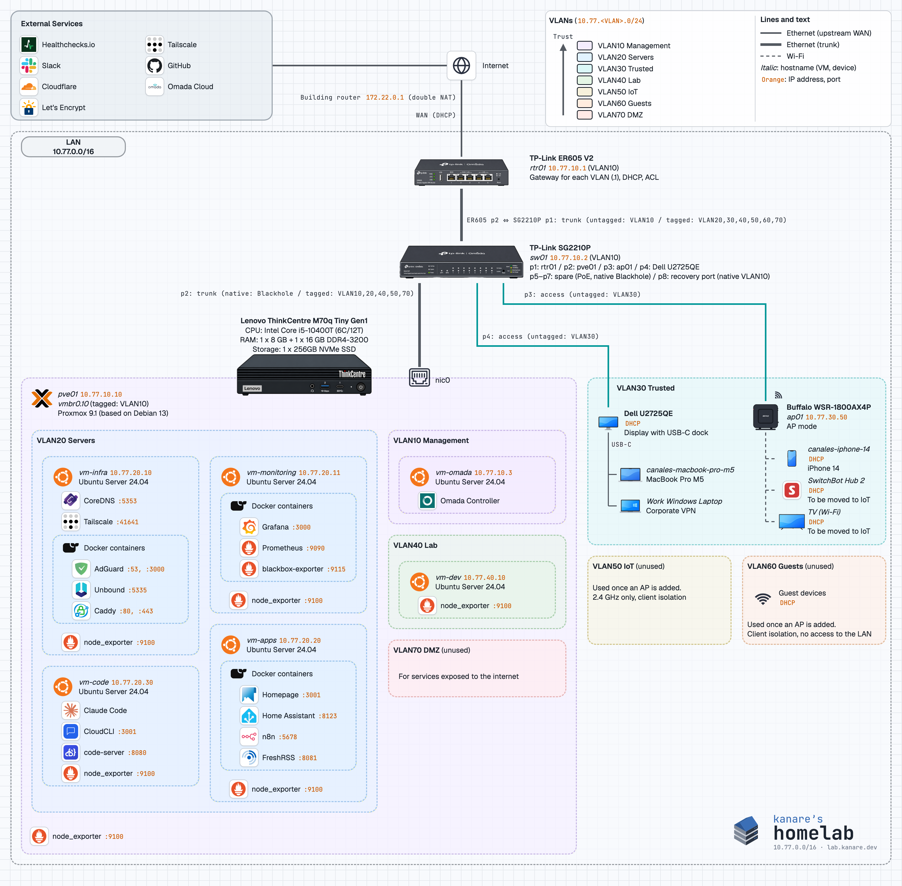
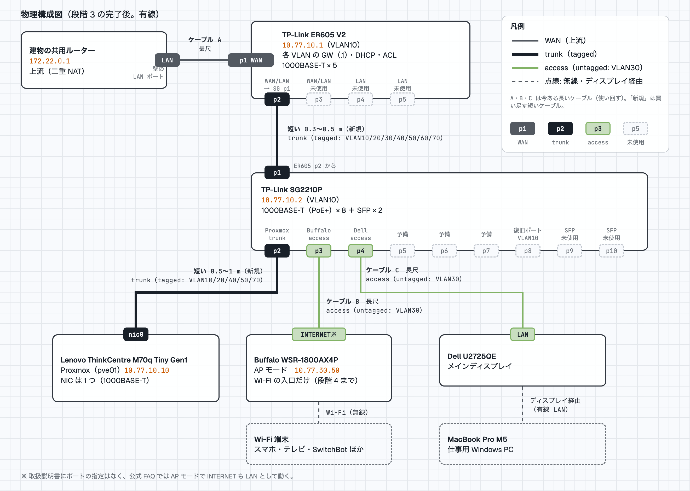
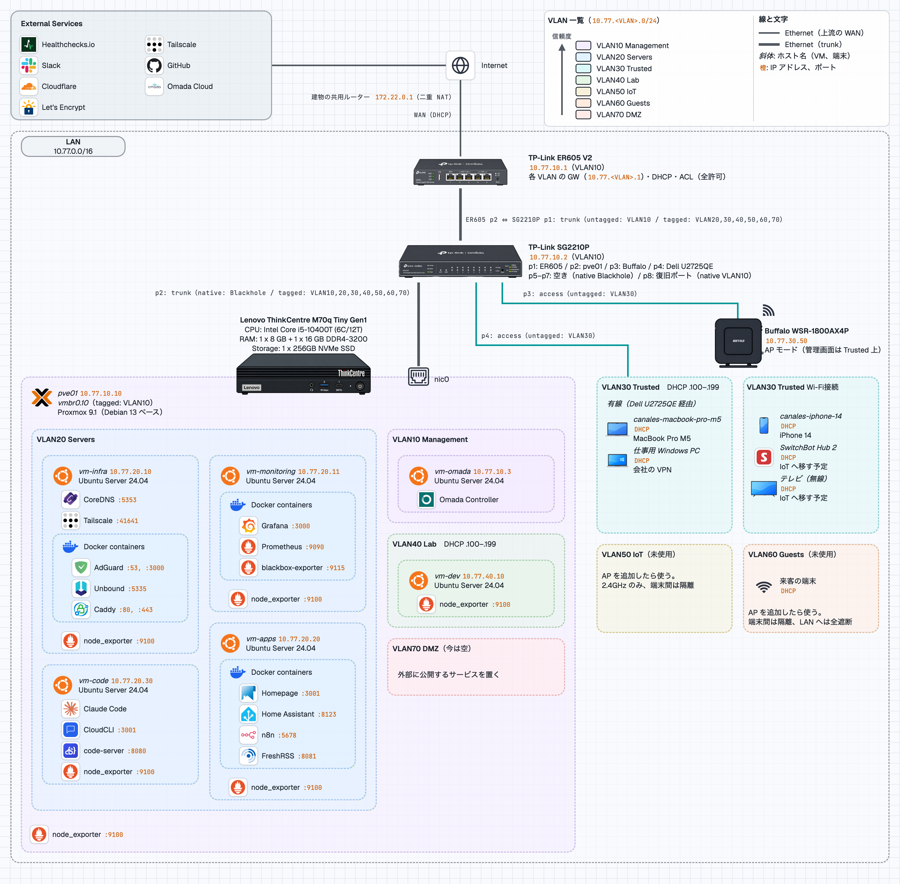
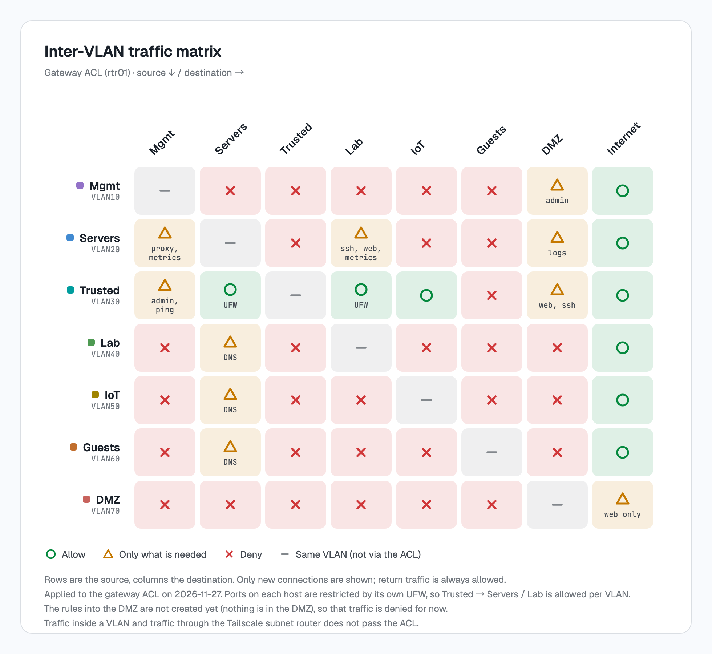

# diagrams

構成図と、その生成・整形スクリプト。ディレクトリは、図の役割で分ける。

| ディレクトリ | 役割 |
| --- | --- |
| [`to-be-diagram/`](#to-be-の構成図-vlan-化のあとto-be-diagram) | **to-be の構成図**（最終形。VLAN 化のあと、管理系も VLAN10）。単体の HTML と PNG |
| [`physical-diagram/`](#物理構成図physical-diagram) | **物理構成図**（機器のポートとケーブル）。単体の HTML と PNG |
| [`as-is-diagram/`](#現状の構成図as-is-diagram) | **現状の構成図**（as-is。常に実機の状態を表す。削除しない）。単体の HTML と PNG。to-be の構成図と同じ見た目 |
| [`acl-matrix/`](#vlan-間の通信マトリクスacl-matrix) | **VLAN 間の通信マトリクス**（ゲートウェイの ACL。2026-11-27 に適用）。単体の HTML と PNG |
| `fonts/`、`assets/` | 図が使うフォントとアイコン素材 |

## 構成図

### to-be の構成図: VLAN 化のあと（`to-be-diagram/`）

ER605 と SG2210P を入れて VLAN に分けた**最終形（to-be）**。管理系も VLAN10 に移した、段階 3b の後の構成。VLAN ごとのアドレス、スイッチのポートの割り当て、通信ポリシーの要約。内容は [ER605・SG2210P の移行計画](../operations/roadmap/10-er605-sg2210p-migration-plan.md)の「段階 3 の後」と [第5章 ネットワーク](../architecture/hld/05-network.md)による。**目指す姿として、計画・設計が変わったときに、随時更新する。** 現状（as-is）は、次の「現状の構成図」で、この図を追いかける。**本体は、生成スクリプト [`to-be-diagram/make-to-be-diagram.py`](to-be-diagram/make-to-be-diagram.py)**（座標と文字を持つ）。HTML と PNG は、そこから書き出す。

<picture>
  <source media="(prefers-color-scheme: dark)" srcset="to-be-diagram/to-be-diagram-dark.png">
  
</picture>

ダーク版は [`to-be-diagram-dark.png`](to-be-diagram/to-be-diagram-dark.png)、ロゴとフォントを埋め込んだ単体の HTML は [`to-be-diagram.html`](to-be-diagram/to-be-diagram.html)（ブラウザで開ける。OS のダークモードに追従する）。

- 見た目は、背景の方眼（20px）、フォント（Geist と JetBrains Mono。日本語は Hiragino / Noto Sans JP）、ライト・ダークの切り替え、線のラベルの縁取り。VLAN ごとの枠の色、VM・Docker の入れ子、サービスの行（白いタイルにロゴ）、凡例は、最初に描いた移行前の図（削除済み）の形を引き継いだ。細かい寸法は、スクリプトの冒頭に書いてある。
- 以前は draw.io の SVG（`tobe-vlan.drawio.svg`）だったが、書き出す SVG に方眼を入れられず、フォントも埋め込めないため、HTML に移した（2026-11-06）。draw.io での手直しは、できなくなった。直すときは、スクリプトの「配置」を直す。
- フォントは [`fonts/`](fonts/)（OFL。`OFL-*.txt` が各ライセンス。物理構成図と共通）を、HTML に埋め込む。

### 物理構成図（`physical-diagram/`）

どの機器のどのポートを、どの機器のどのポートに繋ぐかを、一目で見るための図。段階 3 の完了後の、有線の最終形。機器は四角、ポートは四角（WAN・trunk・access VLAN30・未使用を色で区別）、ケーブルは線（太さと色で種類を区別）で描く。ケーブルの種類（今ある長いケーブル A・B・C と、買い足す短いケーブル）と、ポートごとの VLAN（tagged / untagged）も載せた。VM・サービス・IP は、[to-be の構成図](#to-be-の構成図-vlan-化のあとto-be-diagram)に任せる。内容は、[移行計画](../operations/roadmap/10-er605-sg2210p-migration-plan.md)の「段階 3 の後」「ケーブルと電源」と、[ER605](../architecture/lld/network/omada-controller.md#er605ルーター)・[SG2210P](../architecture/lld/network/omada-controller.md#sg2210pスイッチ) のポート表による。**本体は、生成スクリプト [`physical-diagram/make-physical-diagram.py`](physical-diagram/make-physical-diagram.py)**。

<picture>
  <source media="(prefers-color-scheme: dark)" srcset="physical-diagram/physical-diagram-dark.png">
  
</picture>

ダーク版は [`physical-diagram-dark.png`](physical-diagram/physical-diagram-dark.png)、単体の HTML は [`physical-diagram.html`](physical-diagram/physical-diagram.html)。

- スタイル（方眼、フォント、ライト・ダーク、線のラベルの縁取り）は、to-be の構成図と同じ。フォントは [`fonts/`](fonts/)（共通）を使う。
- **Buffalo のポート**: 図は INTERNET ポートで描き、「INTERNET※」と注記した。取扱説明書（2026-11-06 に確認）に、AP モードの接続ポートの指定はなく、公式 FAQ では、ブリッジモードで INTERNET も LAN として動くとある（[Buffalo の資料](../architecture/lld/hardware/wsr-1800ax4p.md)）。
- ER605 のポートの種類（p1 が WAN、p2・p3 が WAN/LAN、p4・p5 が LAN）は、運用者が本体で確認した値。[ER605 の資料](../architecture/lld/hardware/er605.md)と、[ER605 の設定](../architecture/lld/network/omada-controller.md#er605-のポート)にも書いた。
- 配線を変えたら（ポートの割り当て、ケーブルの付け替え）、同じ変更で、スクリプトの「配置」と、移行計画・設計書のポート表を直す。

### 現状の構成図（`as-is-diagram/`）

**現状（as-is）**の構成。**常に実機の状態を表し、削除しない。** to-be の構成図（`to-be-diagram/`）は目指す姿で、随時更新する。as-is は、それを追いかけて、実機を変えたときに更新する。実機が to-be に追いつけば、2 枚は、ほぼ同じ形になる。違いが残るのは、実機にしかない事情（ACL が全許可か絞ったあとかなど）と、まだ実機に反映していない計画（2026-11-19 時点では、Proxmox ホストの `vmbr0.10` への移動と、既定のネットワークの VLAN10 への統合）。

<picture>
  <source media="(prefers-color-scheme: dark)" srcset="as-is-diagram/as-is-diagram-dark.png">
  
</picture>

ダーク版は [`as-is-diagram-dark.png`](as-is-diagram/as-is-diagram-dark.png)、単体の HTML は [`as-is-diagram.html`](as-is-diagram/as-is-diagram.html)。

- スクリプト（`make-as-is-diagram.py`）は、`to-be-diagram/make-to-be-diagram.py` を写して、配置と文字を現状に合わせたもの。部品と見た目の決まりは同じ。実機を変えたら（IP、VLAN、ポート）、スクリプトの「配置」を直して、`python3 docs/diagrams/as-is-diagram/make-as-is-diagram.py --png` を実行する。
- 内容の正は、[IP アドレス一覧](../architecture/lld/network/ip-addresses.md)と、[Omada コントローラー](../architecture/lld/network/omada-controller.md)（ER605・SG2210P）と [Buffalo](../architecture/lld/network/wsr-1800ax4p.md) の設定の文書。食い違ったら、文書のほうが正。
- **段階 3b（管理系を VLAN10 へ）が済んだら、現状と to-be が同じになるので、このディレクトリごと削除する。**

### VLAN 間の通信マトリクス（`acl-matrix/`）

VLAN の間で、どの向きの新規の接続を許すかを、一目で見るための図。縦が送信元、横が宛先で、許可・必要な通信だけ・拒否・同じ VLAN の 4 つの記号で示す。「必要な通信だけ」のセルには、許す通信を短く書いた。内容の正は、[第5章 ネットワーク](../architecture/hld/05-network.md#通信ポリシー)の許可表と [ADR-0034](../adr/0034-acl-for-vlan-boundaries-ufw-for-ports.md)。ゲートウェイの ACL の**目標**で、今の ACL は全許可のまま（[ADR-0029](../adr/0029-stage3-acl-allow-all-then-tighten.md)）。**本体は、生成スクリプト [`acl-matrix/make-acl-matrix.py`](acl-matrix/make-acl-matrix.py)**（冒頭の `MATRIX` が表の中身）。許可表を変えたら、同じ変更で `MATRIX` を直して書き出す。

<picture>
  <source media="(prefers-color-scheme: dark)" srcset="acl-matrix/acl-matrix-dark.png">
  
</picture>

ダーク版は [`acl-matrix-dark.png`](acl-matrix/acl-matrix-dark.png)、単体の HTML は [`acl-matrix.html`](acl-matrix/acl-matrix.html)。見た目（フォント、ライト・ダーク、VLAN の色）は構成図に揃えた。

## ファイル

| ファイル | 内容 |
| --- | --- |
| `to-be-diagram/` | to-be の構成図（最終形）。生成スクリプト `make-to-be-diagram.py`（本体）、書き出した `to-be-diagram.html`・`to-be-diagram.png`・`to-be-diagram-dark.png` |
| `as-is-diagram/` | 現状の構成図（**常に実機の状態を表す。削除しない**）。生成スクリプト `make-as-is-diagram.py`（本体）、書き出した `as-is-diagram.html`・`as-is-diagram.png`・`as-is-diagram-dark.png` |
| `physical-diagram/` | 物理構成図（段階 3 の完了後の配線）。生成スクリプト `make-physical-diagram.py`（本体）、書き出した `physical-diagram.html`・`physical-diagram.png`・`physical-diagram-dark.png` |
| `acl-matrix/` | VLAN 間の通信マトリクス（ゲートウェイの ACL）。生成スクリプト `make-acl-matrix.py`（本体）、書き出した `acl-matrix.html`・`acl-matrix.png`・`acl-matrix-dark.png` |
| `fonts/` | HTML 図（to-be、as-is、物理構成図、通信マトリクス）が埋め込むフォント（Geist、JetBrains Mono。OFL） |
| `assets/` | アイコン素材（**Git 管理外**。無ければ取得する） |

## 更新の手順

構成を変えたら（VM・サービス・IP・機器の追加や削除）、同じ変更で図も更新する。

1. スクリプトの「配置」を直す。
2. 実行する。

   ```bash
   python3 docs/diagrams/as-is-diagram/make-as-is-diagram.py --png              # 現状の構成図（HTML と PNG。macOS の `sips` と Google Chrome が要る）
   python3 docs/diagrams/to-be-diagram/make-to-be-diagram.py --png              # to-be の構成図（同上。計画が変わったときだけ）
   python3 docs/diagrams/physical-diagram/make-physical-diagram.py --png        # 物理構成図（HTML と PNG。Google Chrome が要る）
   python3 docs/diagrams/acl-matrix/make-acl-matrix.py --png                    # 通信マトリクス（同上。通信ポリシーを変えたときだけ）
   ```

3. 書き出した図を目で見て、崩れていないか確かめる。現状の構成図は `as-is-diagram.png`（ライト）と `as-is-diagram-dark.png`（ダーク）、to-be の構成図は `to-be-diagram.png` と `to-be-diagram-dark.png`、物理構成図は `physical-diagram.png` と `physical-diagram-dark.png`。
4. スクリプトと、書き出したファイル（HTML と PNG 2 枚）を、**一緒に**コミットする。
5. 実行で出る `docs/diagrams/__pycache__/` は消す。
