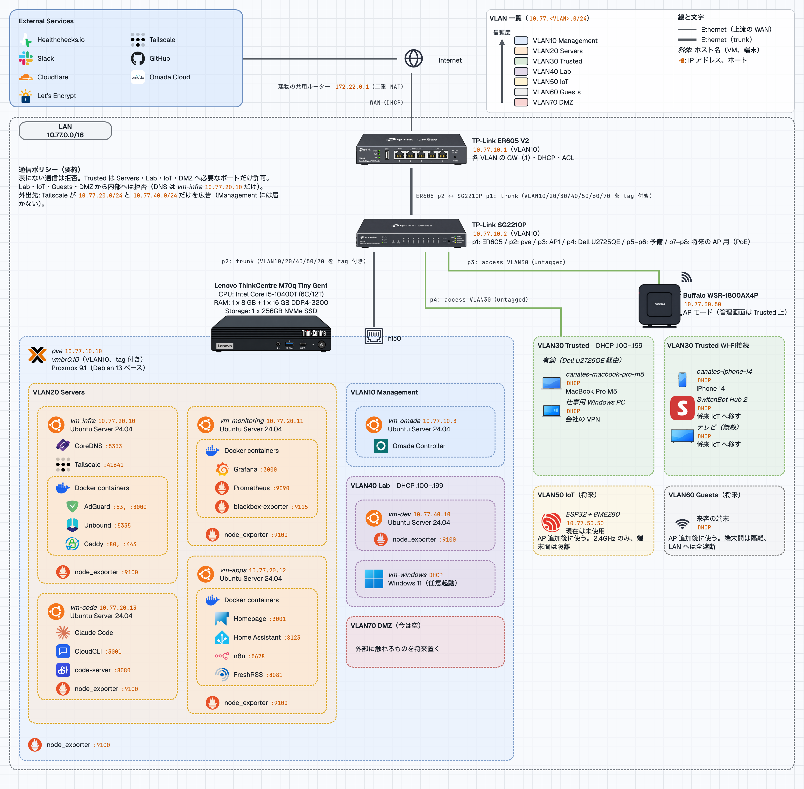
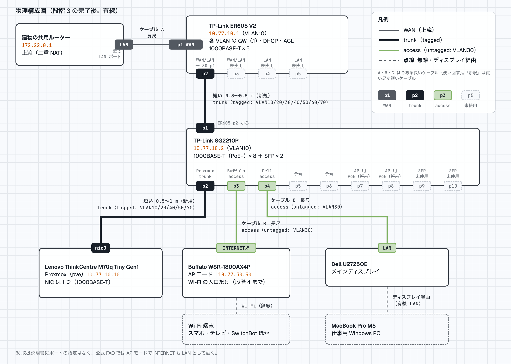
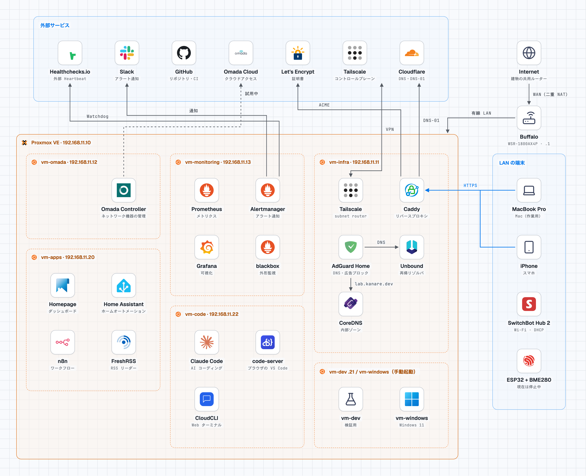

# diagrams

構成図と、その生成・整形スクリプト。現行の構成図は、draw.io の XML を埋め込んだ SVG（`architecture.drawio.svg`）で、ブラウザや Markdown でそのまま見られ、draw.io で開いて編集もできる。VLAN 化のあとの構成図は、単体の HTML（`tobe-html/`）で、Markdown からは PNG で参照する。

## 構成図

### 現行の構成（`architecture.drawio.svg`）

Buffalo がルーターの、今の構成。VM とサービス、外部サービス、LAN の端末。最新版の ASCII 図は [システム概要](../architecture/01-overview.md) にある（食い違っていたら、ASCII 図が正）。


### VLAN 化のあとの構成（`tobe-html/`）

ER605 と SG2210P を入れて VLAN に分けたあと（段階 3 の完了時点）の構成。VLAN ごとのアドレス、スイッチのポートの割り当て、通信ポリシーの要約。内容は [ER605・SG2210P の移行計画](../operations/roadmap/10-er605-sg2210p-migration-plan.md)の「段階 3 の後」と [VLAN 設計](../architecture/08-vlan-design.md)による。**本体は、生成スクリプト [`tobe-html/make-tobe-vlan.py`](tobe-html/make-tobe-vlan.py)**（座標と文字を持つ）。HTML と PNG は、そこから書き出す。



ダーク版は [`tobe-vlan-dark.png`](tobe-html/tobe-vlan-dark.png)、ロゴとフォントを埋め込んだ単体の HTML は [`tobe-vlan.html`](tobe-html/tobe-vlan.html)（ブラウザで開ける。OS のダークモードに追従する）。

- 見た目は、背景の方眼（20px）、フォント（Geist と JetBrains Mono。日本語は Hiragino / Noto Sans JP）、ライト・ダークの切り替え、線のラベルの縁取り。VLAN ごとの枠の色、VM・Docker の入れ子、サービスの行（白いタイルにロゴ）、凡例は、現行の図の形を引き継いだ。細かい寸法は、スクリプトの冒頭に書いてある。
- 以前は draw.io の SVG（`tobe-vlan.drawio.svg`）だったが、書き出す SVG に方眼を入れられず、フォントも埋め込めないため、HTML に移した（2026-11-06）。draw.io での手直しは、できなくなった。直すときは、スクリプトの「配置」を直す。
- フォントは [`fonts/`](fonts/)（OFL。`OFL-*.txt` が各ライセンス。物理構成図と共通）を、HTML に埋め込む。

### 物理構成図（`physical/`）

どの機器のどのポートを、どの機器のどのポートに繋ぐかを、一目で見るための図。段階 3 の完了後の、有線の最終形。機器は四角、ポートは四角（WAN・trunk・access VLAN30・未使用を色で区別）、ケーブルは線（太さと色で種類を区別）で描く。ケーブルの種類（今ある長いケーブル A・B・C と、買い足す短いケーブル）と、ポートごとの VLAN（tagged / untagged）も載せた。VM・サービス・IP は、上の論理側の図に任せる。内容は、[移行計画](../operations/roadmap/10-er605-sg2210p-migration-plan.md)の「段階 3 の後」「ケーブルと電源」と、[ER605](../services/13-er605.md)・[SG2210P](../services/14-sg2210p.md) のポート表による。**本体は、生成スクリプト [`physical/make-physical.py`](physical/make-physical.py)**。



ダーク版は [`physical-dark.png`](physical/physical-dark.png)、単体の HTML は [`physical.html`](physical/physical.html)。

- スタイル（方眼、フォント、ライト・ダーク、線のラベルの縁取り）は、VLAN 化のあとの図と同じ。フォントは [`fonts/`](fonts/)（共通）を使う。
- **Buffalo のポート**: 図は INTERNET ポートで描き、「INTERNET※」と注記した。取扱説明書（2026-11-06 に確認）に、AP モードの接続ポートの指定はなく、公式 FAQ では、ブリッジモードで INTERNET も LAN として動くとある（[Buffalo の資料](../hardware/wsr-1800ax4p.md)）。
- ER605 のポートの種類（p1 が WAN、p2・p3 が WAN/LAN、p4・p5 が LAN）は、運用者が本体で確認した値。[ER605 の資料](../hardware/er605.md)と、[ER605 の設定](../services/13-er605.md#ポート)にも書いた。
- 配線を変えたら（ポートの割り当て、ケーブルの付け替え）、同じ変更で、スクリプトの「配置」と、移行計画・設計書のポート表を直す。

### stack-diagram で描いた現行の構成（`stack-diagram/`、試作）

[stack-diagram](https://github.com/caru-ini/stack-diagram)（エージェント用のスキル。公式のロゴで構成図を描く）を試した図。内容は現行の構成で、`architecture.drawio.svg` と同じ範囲（外部サービス、Buffalo、Proxmox 上の VM とサービス、LAN の端末）を、日本語で描いた。**正は、これまでの `architecture.drawio.svg` のまま**で、これは比較用の試作。ライト・ダークの PNG と、ロゴと文字を埋め込んだ単体の HTML（ブラウザで開ける）がある。



ダーク版は [`homelab-dark.png`](stack-diagram/homelab-dark.png)、HTML は [`homelab.html`](stack-diagram/homelab.html)。

- スキルは、`~/.claude/skills/stack-diagram` に入れた（リポジトリの外。確認した版は、リポジトリ `caru-ini/stack-diagram` の `1ed53e3`）。導入の前に、`SKILL.md` とスクリプトを読んで、危険な呼び出しがないことを確かめた。
- **スキルの「ギャラリーへの公開」（`share.py`）は使わない。** 図に内部の IP アドレスが入っているため。
- 生成は [`stack-diagram/make-homelab.py`](stack-diagram/make-homelab.py)（座標を計算して下書きの HTML を作る）。ロゴ（`<icons-dir>`、Git 管理外）は、スキルの `fetch_icons.py` で取得する。取れなかったもの（Caddy、AdGuard Home、Unbound、CoreDNS、FreshRSS、code-server、Healthchecks.io、Let's Encrypt、Homepage、Omada、SwitchBot、ESP32、CloudCLI）は、`assets/icons/` にある既存の素材を使った。
- PNG の書き出しには、Playwright と Chromium が要る。

## ファイル

| ファイル | 内容 |
| --- | --- |
| `architecture.drawio.svg` | 現行の構成図 |
| `layout-architecture.py` | 現行の構成図の座標・文字を、規格どおりに組み直すスクリプト |
| `tobe-html/` | VLAN 化のあとの構成図。生成スクリプト `make-tobe-vlan.py`（本体）、書き出した `tobe-vlan.html`・`tobe-vlan.png`・`tobe-vlan-dark.png` |
| `fonts/` | 2 つの HTML 図が埋め込むフォント（Geist、JetBrains Mono。OFL） |
| `physical/` | 物理構成図（段階 3 の完了後の配線）。生成スクリプト `make-physical.py`（本体）、書き出した `physical.html`・`physical.png`・`physical-dark.png` |
| `stack-diagram/` | stack-diagram で描いた現行の構成図（試作）。`homelab.html`、`homelab.png`、`homelab-dark.png`、生成スクリプト `make-homelab.py` |
| `assets/` | アイコン素材（**Git 管理外**。無ければ取得する） |

## 更新の手順

構成を変えたら（VM・サービス・IP・機器の追加や削除）、同じ変更で図も更新する。

1. スクリプトの「配置」を直す。
2. 実行する。

   ```bash
   python3 docs/diagrams/layout-architecture.py            # 現行（draw.io のデスクトップ版が要る。`brew install --cask drawio`）
   python3 docs/diagrams/tobe-html/make-tobe-vlan.py --png # VLAN 化のあと（HTML と PNG。macOS の `sips` と Google Chrome が要る）
   python3 docs/diagrams/physical/make-physical.py --png   # 物理構成図（HTML と PNG。Google Chrome が要る）
   ```

3. 書き出した図を目で見て、崩れていないか確かめる。現行は `drawio -x -f png -b 20 -o <出力先>.png architecture.drawio.svg`、VLAN 化のあとは `tobe-vlan.png`（ライト）と `tobe-vlan-dark.png`（ダーク）、物理構成図は `physical.png` と `physical-dark.png`。
4. スクリプトと、書き出したファイル（現行は SVG、VLAN 化のあとと物理構成図は、それぞれ HTML と PNG 2 枚）を、**一緒に**コミットする。
5. 実行で出る `docs/diagrams/__pycache__/` は消す。

## draw.io での手直しがあるとき（現行の図）

`architecture.drawio.svg` は、draw.io で直接手直しされることがある。**確認せずに再生成すると、手直しが消える**（過去に起きた）。VLAN 化のあとの図は HTML なので、この心配は無い（直すのは、スクリプトだけ）。

- スクリプトを実行する前に、**現在の SVG と、スクリプトが出す内容を、セルごとに比べる**（位置、大きさ、文字、スタイル）。スクリプトが `KeyError` で止まったら、手直しでセルの ID が変わった印。
- 手直しは、**先にスクリプトへ取り込んで**から再生成する。取り込んだあとは、再生成した SVG と手直しの SVG が、見た目も意味も同じになることを確認する。
- 手直しは、運用者が直接コミットすることもある。`git log` で、スクリプトを通っていない図のコミットを確かめる。
