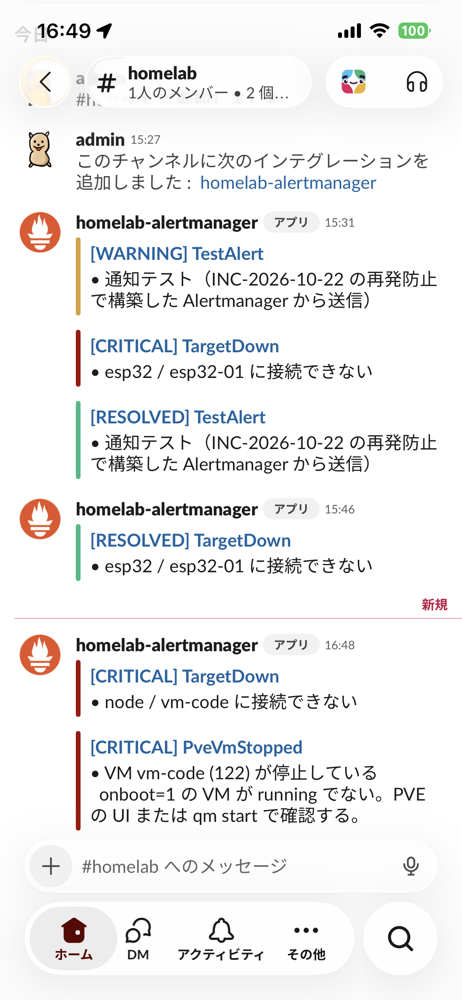
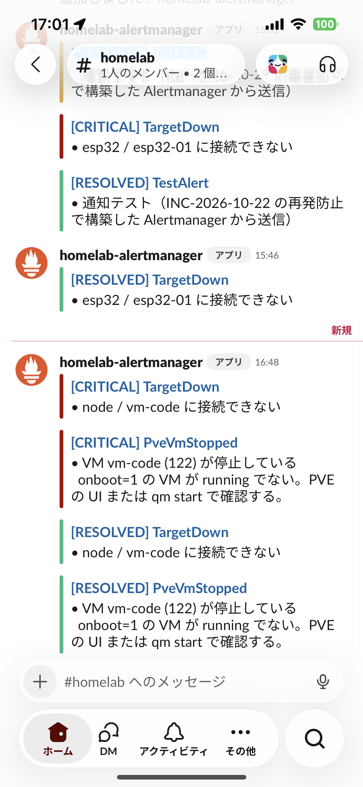

# 監視・アラート

homelab の監視とアラート通知の仕組み。2026-10-22 の障害（[INC-2026-10-22](../operations/incidents/2026-10-22-lvm-thin-exhaustion.md)）を受けて、容量枯渇と VM 停止を検知して Slack に通知する構成にした。

## 全体像

```text
 pve (192.168.11.10)
  ├─ node_exporter :9100 ─────────────┐
  └─ pve-storage-metrics.timer (1分毎)│  thin pool Data%/Meta%, VM 稼働状態, io-error
       -> /var/lib/node_exporter/textfile/pve_storage.prom
                                      │
 vm-infra / vm-apps / vm-dev / vm-code / vm-monitoring
  └─ node_exporter :9100 ─────────────┤
                                      v
                       vm-monitoring (192.168.11.13)
                        Prometheus :9090  (15秒毎に scrape, alerts.yml を評価)
                              │ 発報
                              v
                        Alertmanager :9093 ──> Slack Incoming Webhook (#homelab-alerts)
                              ^
                        Grafana :3000 (可視化。通知には関与しない)
```

## 構成要素と置き場所

| 要素 | 役割 | ファイル |
| --- | --- | --- |
| node_exporter | ホストのメトリクス公開（全ホスト）。textfile collector 有効 | `ansible/roles/node_exporter/` |
| pve-storage-metrics | PVE 専用。thin pool と VM 状態を textfile に出力 | `ansible/roles/proxmox/files/pve-storage-metrics.sh`、`ansible/roles/proxmox/tasks/main.yml` |
| unbound-metrics | vm-infra 専用。未キャッシュの名前を Unbound に直接引いて、再帰解決できているかを textfile に出力（1 分毎） | `ansible/roles/dns_metrics/` |
| Prometheus | 収集・ルール評価。`retention.time=30d`、`retention.size=5GB` | `docker/compose/monitoring/prometheus/prometheus.yml`、`docker-compose.yml` |
| アラートルール | 発報条件 | `docker/compose/monitoring/prometheus/alerts.yml` |
| Alertmanager | 通知のグルーピング・送信 | `docker/compose/monitoring/alertmanager/alertmanager.yml` |
| Slack Webhook URL | 秘密情報 | `ansible/inventory/group_vars/monitoring/secrets.sops.yml`（`slack_webhook_url`、SOPS 暗号化） |
| Grafana ダッシュボード「Storage / Thin Pool」 | pool とVM ディスク別の割当、増加ペース、VM 稼働状態 | `docker/compose/monitoring/grafana/dashboards/storage.json`（`/d/homelab-storage`） |
| デプロイ | | `ansible/playbooks/monitoring.yml`（vm-monitoring）、`ansible/playbooks/proxmox.yml`（pve） |

## 監視している項目

| アラート | 条件 | 待ち時間 | 重大度 | 検知できる障害 |
| --- | --- | --- | --- | --- |
| LvmThinPoolDataHigh | thin pool Data% > 75% | 5m | warning | ストレージ枯渇の予兆 |
| LvmThinPoolDataCritical | thin pool Data% > 90% | 2m | critical | 枯渇間近（今回の障害の原因） |
| LvmThinPoolMetadataHigh / Critical | thin pool Meta% > 75% / 90% | 5m / 2m | warning / critical | メタデータ枯渇 |
| LvmThinPoolOverprovisioned | 仮想ディスク合計 ÷ pool サイズ > 1.5 | 1h | warning | 過剰割当（障害時は約 1.6、現在 1.44）。全 VM が使い切れば枯渇する |
| AlertmanagerNotificationsFailing | Alertmanager → Slack の送信失敗が 10 分間に増加 | 5m | warning | Webhook 失効や Slack 障害。**Slack には届かない**ため、Alertmanager / Prometheus の画面でのみ確認できる |
| PveVmIoError | VM が `io-error` | 1m | critical | ストレージ枯渇による VM 一時停止 |
| PveVmStopped | `onboot=1` の VM が running でない | 3m | critical | VM のシャットダウン・クラッシュ・手動停止（vm-infra / vm-apps / vm-monitoring / vm-code が対象） |
| TargetDown | scrape 先が応答しない（vm-dev 除く） | 3m | critical | VM 内 OS の停止・node_exporter 停止・ネットワーク断 |
| HostDiskUsageHigh / Critical | ファイルシステム > 80% / 90% | 10m / 5m | warning / critical | ゲスト・ホストのディスク逼迫 |
| HostMemoryLow / Critical | 利用可能メモリ < 10% / 5%（`MemAvailable`） | 5m / 2m | warning / critical | OOM によるハングの予兆（vm-code で発生）。ホストと全 VM が対象 |
| HostOomKilled | 10 分間に OOM killer が発動 | 0 | critical | OOM kill の発生。対象は `dmesg \| grep -i oom` で確認 |
| HostCpuHigh / Critical | CPU 使用率（全コア平均、idle 以外）> 85% / 95% | 15m / 10m | warning / critical | 暴走プロセス・ビルド等の高負荷、vCPU 不足。ホストと全 VM が対象 |
| PveStorageMetricsStale | thin pool メトリクスが 5 分以上更新されない | 5m | warning | 収集タイマーの停止（監視の盲点） |
| PveStorageMetricsMissing | thin pool メトリクスが存在しない | 10m | warning | 収集の欠落 |
| UnboundProbeFailing | Unbound が未キャッシュの名前を再帰解決できない（SERVFAIL・タイムアウト） | 3m | warning | Unbound の停止・上流断。AdGuard の fallback DNS で名前解決は続くため、**利用者は気づけない**障害 |
| UnboundProbeStale / Missing | プローブが 5 分以上更新されない / メトリクスが存在しない | 5m / 10m | warning | `unbound-metrics.timer` の停止（監視の盲点） |
| Watchdog | 常に firing | - | none | 通知経路の死活確認（Slack には送らない） |

### 通知の挙動

- 同じ `alertname` + `instance` を 1 通にまとめる。最初の通知まで 30 秒待つ。
- 未解消なら critical は 1 時間毎、それ以外は 4 時間毎に再通知する。
- 解消時は `[RESOLVED]` を送る。

## 容量の上限設定

ログや時系列データが増え続けないよう、次の上限を設けている（INC-2026-10-22）。

| 対象 | 上限 | 設定場所 |
| --- | --- | --- |
| Prometheus TSDB | 30 日 または 5GB | `docker/compose/monitoring/docker-compose.yml`（5GB は暫定値。実測で調整） |
| Docker コンテナログ（monitoring / dns / reverse-proxy / homepage） | 10MB × 3 ファイル | 各 `docker-compose.yml` の `x-logging` |
| journald（全 VM） | 200M、1 か月 | `ansible/roles/common`（`journald_system_max_use`、`journald_max_retention`） |
| AdGuard Home クエリログ | 7 日（168h） | `ansible/playbooks/infra.yml`、`group_vars/infra/vars.yml` |
| thin pool の未使用ブロック返却 | 毎週 `fstrim.timer` | `ansible/roles/common` |

## 動作確認の記録

| 日付 | 内容 | 結果 |
| --- | --- | --- |
| 2026-10-22 | `TestAlert` を Alertmanager に直接送信 | Slack に `[WARNING] TestAlert` が届いた |
| 2026-10-22 | vm-code を `qm shutdown` で停止（実機テスト） | 停止から約 3.5 分で `TargetDown`、約 4 分で `PveVmStopped` が発報。Slack に両方届いた（ユーザー確認）。起動後 1 分以内にアラートは解消 |
| 2026-10-22 | Unbound の実障害（`do-ip6` が有効で `max-sends` 超過 → 未キャッシュの名前が `SERVFAIL`） | `UnboundProbeFailing` が pending になり、検知できた。`do-ip6: no` で解消（[dns.md](dns.md)）。待ち時間（3 分）内に復旧したため、Slack 通知は未確認 |

VM 停止の検知は、`TargetDown`（VM 内 OS の応答なし）が 3 分、`PveVmStopped`（PVE が見ている状態）が 3 分の待ち時間に、スクレイプ間隔と評価間隔が加わって、約 4 分で通知される。

### Slack の通知画面（スマホアプリ）

2026-10-22 の動作確認時に、iPhone の Slack アプリで受信した画面。左は発報時（`TestAlert` と、vm-code 停止による `TargetDown` / `PveVmStopped`）、右は復旧後に `[RESOLVED]` が届いた状態。

<p>
  
  
</p>

## 意図的に監視していないもの

| 対象 | 理由 |
| --- | --- |
| vm-dev の TargetDown | `onboot=false` で手動起動のため。停止しても通知しない |
| ESP32 (`192.168.11.100`) | 現在意図的に停止中。`prometheus.yml` の `esp32` ジョブをコメントアウト済み。再開時はコメントを外す |
| vm-windows の停止・OS 内部 | `onboot=0` のため停止しても通知しない。node_exporter も未導入。io-error は PVE 側のメトリクスで検知できる |
| ubuntu-cloud (9000) | テンプレート VM |

## 限界（既知の弱点）

1. **監視 VM 自身が止まると通知されない**。vm-monitoring は PVE と同じストレージ・ホスト上にある。PVE ホストの停止、vm-monitoring の停止、ストレージ全体の障害では Slack に何も届かない。今回の障害と同じ構造で、完全には防げていない。
2. **PVE ホスト自体が落ちた場合も通知されない**（上と同じ理由）。
3. 外部監視による補完は**現時点では行わない**（判断は下記「外部監視を導入しない判断」を参照）。
4. Slack への送信失敗は `AlertmanagerNotificationsFailing` で検知するが、Slack に届かないので **UI（`http://192.168.11.13:9093`）を見ないと気づけない**。

### 外部監視を導入しない判断（2026-10-22）

判断の記録: [ADR-0002](../adr/0002-no-external-monitoring.md)

**判断**: 監視 VM・PVE ホストの停止を検知する外部監視は、現時点では導入しない。上記 1・2 のリスクは認識したうえで受け入れる。

**理由**:

- 個人の homelab であり、本番サービスのように停止の即時検知が必須ではない。
- 外部サービスのアカウント管理・Webhook/ping URL の秘密情報管理が増える。
- 今回の障害（thin pool 枯渇）は、容量アラートで枯渇前に検知できる想定。ホストそのものの停止は、DNS 不達などの症状で気づける。

**受け入れたリスク**: PVE ホスト停止、vm-monitoring 停止、ストレージ全体障害は、気づくまで通知されない。気づく手段は、DNS・Homepage が使えない症状、または定期的な目視確認のみ。

**再検討の目安**: 不在中に長時間気づけず困った、Home Assistant などの常時稼働が必要なサービスを載せた、または再び監視 VM を巻き込む障害が起きた場合。

**将来の選択肢**:

| 案 | 内容 | 長所 | 短所 |
| --- | --- | --- | --- |
| A. 外部 Heartbeat（Dead Man's Switch） | `Watchdog` を Healthchecks.io、Better Stack などへ定期送信し、途絶えたら外部から通知 | 監視 VM・ホスト・ネットワークの停止をすべて検知。無料枠で足りる | 外部サービス依存。ping URL の管理が必要 |
| B. 別ホストでの死活監視 | 別マシン（Raspberry Pi、ESP32 など）が PVE と vm-monitoring に ping/HTTP し、Slack に通知 | 外部サービス不要。LAN 内で完結 | 別ハードの用意と保守が必要。停電・回線断では同時に止まる |
| C. VPS 等でのリモート監視 | 外部の VPS で Uptime Kuma などを動かし、Tailscale 経由で死活確認 | 回線断・停電も検知できる | 常時稼働の VPS の費用と運用負担 |
| D. 監視 VM を別ストレージへ分離 | 監視 VM の置き場所を `local`（dir）や別ディスクにする | ストレージ枯渇に巻き込まれない | 別ディスクがない場合は効果が限定的。ホスト停止は検知できない |
| E. 何もしない（現状） | 上記のリスクを受け入れる | 追加コスト・運用負担なし | 停止は気づくまで検知されない |

現在は **E**。導入するなら、手間が最も少ない **A** を第一候補とする。

## 運用

### 収集スクリプトを変更するときの注意

`pve-storage-metrics.sh` の出力に不正な行（値が空など）があると、node_exporter は **ファイル全体を読み込まず**、`node_textfile_scrape_error 1` になって pve のメトリクスが全て消える。変更したら必ず PVE 上で一時ディレクトリに出力して確認する。

```bash
ssh pve 'd=$(mktemp -d); cat > $d/s.sh; bash $d/s.sh $d && grep -cE " $" $d/pve_storage.prom; rm -rf $d' < ansible/roles/proxmox/files/pve-storage-metrics.sh
curl -s http://192.168.11.10:9100/metrics | grep node_textfile_scrape_error   # 0 であること
```

2026-10-22 にボリューム別メトリクスを追加した際、非アクティブなテンプレートボリュームの空値で約 6 分間メトリクスが途絶えた（アラートの待ち時間内で発報はなし）。収集が止まった場合は `PveStorageMetricsStale` / `PveStorageMetricsMissing` が検知する。

### デプロイ

```bash
cd ansible
ansible-playbook -i inventory/hosts.yml playbooks/proxmox.yml      # pve の収集スクリプト・node_exporter
ansible-playbook -i inventory/hosts.yml playbooks/infra.yml        # vm-infra の Unbound プローブ・DNS スタック
ansible-playbook -i inventory/hosts.yml playbooks/monitoring.yml   # Prometheus / Alertmanager / ルール
```

### 設定変更時の検証

```bash
# ルール構文
docker run --rm --entrypoint promtool -v "$PWD/docker/compose/monitoring/prometheus:/p:ro" \
  prom/prometheus:latest check rules /p/alerts.yml
```

### 通知テスト

```bash
curl -XPOST http://192.168.11.13:9093/api/v2/alerts -H 'Content-Type: application/json' \
  -d '[{"labels":{"alertname":"TestAlert","severity":"warning","instance":"manual"},"annotations":{"summary":"通知テスト"}}]'
```

約 30 秒後に Slack へ `[WARNING] TestAlert` が届く。2026-10-22 に動作確認済み。

### 状態確認

| 見たいもの | 場所 |
| --- | --- |
| thin pool の推移・VM ディスク別の割当 | Grafana `http://192.168.11.13:3000/d/homelab-storage/storage-thin-pool` |
| 発報中のアラート | `http://192.168.11.13:9093` / `http://192.168.11.13:9090/alerts` |
| ルールの状態 | `http://192.168.11.13:9090/rules` |
| scrape 先の状態 | `http://192.168.11.13:9090/targets` |
| Slack 送信の成否 | `curl -s http://192.168.11.13:9093/metrics \| grep alertmanager_notifications` |
| PVE の生メトリクス | `curl -s http://192.168.11.10:9100/metrics \| grep -E '^(lvm_thin\|pve_)'` |

### Webhook URL の再発行・変更

Slack App の「Incoming Webhooks」で再発行し、`sops ansible/inventory/group_vars/monitoring/secrets.sops.yml` で `slack_webhook_url` を更新して `monitoring.yml` を再実行する。漏えいが疑われる場合は Slack 側で旧 URL を先に削除する。

## アラート発報時の対応

| アラート | 最初にやること |
| --- | --- |
| LvmThinPoolData* | `ssh pve lvs -o lv_name,data_percent,metadata_percent pve/data`。各 VM で `sudo fstrim -av`。足りなければ `lvextend`。詳細は [runbook](../operations/runbooks/slack-alerts.md#slack-アラート通知) |
| LvmThinPoolOverprovisioned | VM ディスクを増やしすぎている。`lvs` で割当を確認し、pool の拡張、ディスクの縮小、不要な VM の削除を検討する。VG に空きが無ければディスクの追加が必要 |
| PveVmIoError | 先にプールを拡張してから `qm resume <vmid>`。強制リセットしない |
| PveVmStopped | PVE の UI で状態確認。`qm start <vmid>`。意図した停止なら `onboot` の設定を見直す |
| TargetDown | VM が起動しているか、`ssh` できるか、`systemctl status node_exporter` を確認 |
| HostDiskUsage* | `du -xh --max-depth=2 /`、`docker system df` |

## 関連

- [INC-2026-10-22 インシデント記録](../operations/incidents/2026-10-22-lvm-thin-exhaustion.md)
- [運用 Runbook](../operations/runbooks/README.md)
