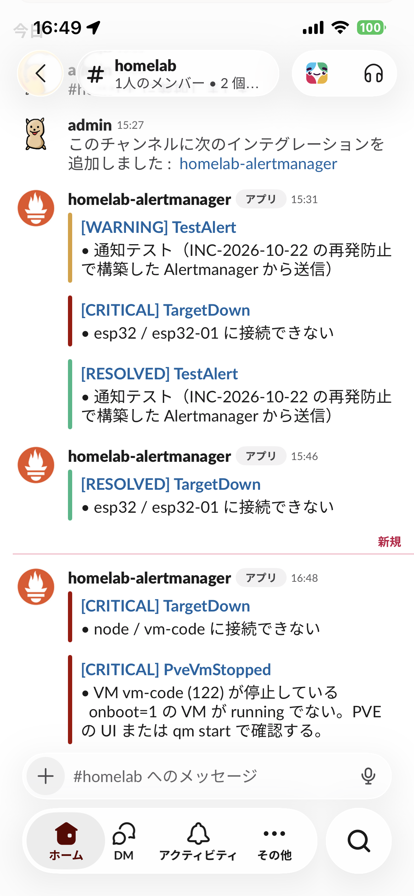
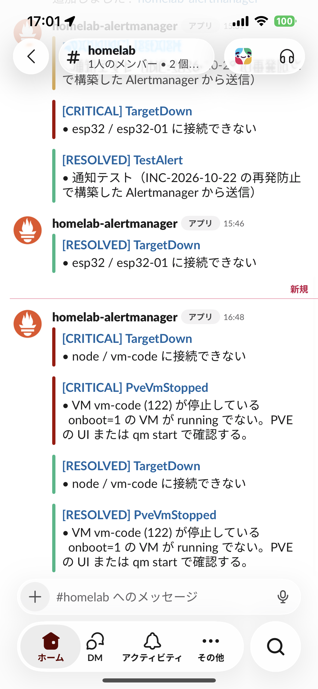

# 監視・アラート

homelab の監視とアラート通知の仕組み。2026-10-22 の障害（[INC-2026-10-22](../../operations/incidents/2026-10-22-lvm-thin-exhaustion.md)）を受けて、容量枯渇と VM 停止を検知して Slack に通知する構成にした。

## 全体像

```text
 pve (192.168.11.10)
  ├─ node_exporter :9100 ─────────────┐
  └─ pve-storage-metrics.timer (1分毎)│  thin pool Data%/Meta%, VM 稼働状態, io-error
       -> /var/lib/node_exporter/textfile/pve_storage.prom
                                      │
 vm-infra / vm-apps / vm-dev / vm-code / vm-monitoring / vm-omada
  └─ node_exporter :9100 ─────────────┤
                                      v
                       vm-monitoring (192.168.11.13)
                        Prometheus :9090  (15秒毎に scrape, alerts.yml を評価)
                              │ /probe (30秒毎)
                              v
                        blackbox-exporter :9115 (コンテナ内のみ)
                          ├─ HTTPS: *.lab.kanare.dev (Caddy 経由、証明書の期限も取得)
                          ├─ DNS: vm-infra AdGuard :53 (内部ゾーン / 外部の名前)
                          └─ ICMP: ルーター / 建物の共用ルーター / 1.1.1.1 / 8.8.8.8 (30秒毎。回線断・遅延)
                              │ 発報
                              v
                        Alertmanager :9093 ──> Slack Incoming Webhook (#homelab-alerts)
                              │ Watchdog (5分毎)
                              └──────────────> Healthchecks.io ──(途絶えたら)──> メール / スマホ通知
                              ^
                        Grafana :3000 (可視化。通知には関与しない)
```

## 構成要素と置き場所

| 要素 | 役割 | ファイル |
| --- | --- | --- |
| node_exporter | ホストのメトリクス公開（全ホスト）。textfile collector 有効 | `ansible/roles/node_exporter/` |
| pve-storage-metrics | PVE 専用。thin pool と VM 状態を textfile に出力 | `ansible/roles/proxmox/files/pve-storage-metrics.sh`、`ansible/roles/proxmox/tasks/main.yml` |
| unbound-metrics | vm-infra 専用。未キャッシュの名前を Unbound に直接引いて、再帰解決できているかを textfile に出力（1 分毎） | `ansible/roles/dns_metrics/` |
| blackbox-exporter | 外形監視。HTTPS と DNS のプローブを実行する。ポートは公開しない（Prometheus からだけ使う） | `docker/compose/monitoring/blackbox/blackbox.yml`、`docker-compose.yml` |
| Prometheus | 収集・ルール評価。`retention.time=30d`、`retention.size=5GB` | `docker/compose/monitoring/prometheus/prometheus.yml`、`docker-compose.yml` |
| アラートルール | 発報条件 | `docker/compose/monitoring/prometheus/alerts.yml` |
| Alertmanager | 通知のグルーピング・送信 | `docker/compose/monitoring/alertmanager/alertmanager.yml` |
| 外部 Heartbeat | `Watchdog` を Healthchecks.io へ 5 分毎に送る。途絶えたら外部から通知（[ADR-0010](../../adr/0010-external-heartbeat.md)） | `alertmanager.yml`（`heartbeat` receiver）、`ansible/playbooks/monitoring.yml` |
| Heartbeat ping URL | 秘密情報 | `ansible/inventory/group_vars/monitoring/secrets.sops.yml`（`heartbeat_ping_url`、SOPS 暗号化） |
| Slack Webhook URL（critical 用 / warning 用） | 秘密情報 | `ansible/inventory/group_vars/monitoring/secrets.sops.yml`（`slack_webhook_url` / `slack_webhook_url_warning`、SOPS 暗号化） |
| Grafana ダッシュボード「Internet Connectivity」 | ping の遅延（ルーター・建物の共用ルーター・インターネット）、疎通、通知しきい値 | `docker/compose/monitoring/grafana/dashboards/internet-connectivity.json`（`/d/homelab-internet-connectivity`） |
| Grafana ダッシュボード「Storage / Thin Pool」 | pool とVM ディスク別の割当、増加ペース、VM 稼働状態 | `docker/compose/monitoring/grafana/dashboards/storage.json`（`/d/homelab-storage`） |
| デプロイ | | `ansible/playbooks/monitoring.yml`（vm-monitoring）、`ansible/playbooks/proxmox.yml`（pve） |

> `vm-omada` の Omada コントローラーの画面（HTTPS）の外形監視は、まだ入れていない。`omada.lab.kanare.dev` を Caddy と DNS に足したあとに、blackbox の HTTPS に加える（[バックログ](../../operations/roadmap/01-backlog.md)）。`vm-omada` の OS の死活は、`node_exporter` の scrape と `TargetDown` で見ている（2026-11-03 から）。

## 監視している項目

| アラート | 条件 | 待ち時間 | 重大度 | 検知できる障害 |
| --- | --- | --- | --- | --- |
| LvmThinPoolDataHigh | thin pool Data% > 75% | 5m | warning | ストレージ枯渇の予兆 |
| LvmThinPoolDataCritical | thin pool Data% > 90% | 2m | critical | 枯渇間近（今回の障害の原因） |
| LvmThinPoolMetadataHigh / Critical | thin pool Meta% > 75% / 90% | 5m / 2m | warning / critical | メタデータ枯渇 |
| LvmThinPoolOverprovisioned | 仮想ディスク合計 ÷ pool サイズ > 1.5 | 1h | warning | 過剰割当（障害時は約 1.6、現在 約 1.05）。全 VM が使い切れば枯渇する |
| AlertmanagerNotificationsFailing | Alertmanager → Slack の送信失敗が 10 分間に増加 | 5m | warning | Webhook 失効や Slack 障害。**Slack には届かない**ため、Alertmanager / Prometheus の画面でのみ確認できる |
| PveVmIoError | VM が `io-error` | 1m | critical | ストレージ枯渇による VM 一時停止 |
| PveVmStopped | `onboot=1` の VM が running でない | 3m | critical | VM のシャットダウン・クラッシュ・手動停止（vm-infra / vm-apps / vm-monitoring / vm-code が対象） |
| TargetDown | scrape 先が応答しない（vm-dev 除く） | 3m | critical | VM 内 OS の停止・node_exporter 停止・ネットワーク断 |
| HostDiskUsageHigh / Critical | ファイルシステム > 80% / 90% | 10m / 5m | warning / critical | ゲスト・ホストのディスク逼迫 |
| HostMemoryLow / Critical | 利用可能メモリ < 10% / 5%（`MemAvailable`） | 5m / 2m | warning / critical | OOM によるハングの予兆（vm-code で発生）。ホストと全 VM が対象 |
| HostOomKilled | 10 分間に OOM killer が発動 | 0 | critical | OOM kill の発生。対象は `dmesg \| grep -i oom` で確認 |
| HostCpuHigh / Critical | CPU 使用率（全コア平均、idle 以外）> 85% / 95% | 15m / 10m | warning / critical | 暴走プロセス・ビルド等の高負荷、vCPU 不足。ホストと全 VM が対象 |
| PveStorageMetricsStale | thin pool メトリクスが 5 分以上更新されない | 5m | warning | 収集タイマーの停止（監視の盲点） |
| PveStorageMetricsMissing | thin pool メトリクスが存在しない | 10m | warning | 収集の欠落 |
| UnboundProbeFailing | Unbound が未キャッシュの名前を再帰解決できない（SERVFAIL・タイムアウト） | 3m | warning | Unbound の停止・上流断。AdGuard の fallback DNS で名前解決は続くため、**利用者は気づけない**障害 |
| UnboundProbeStale / Missing | プローブが 5 分以上更新されない / メトリクスが存在しない | 5m / 10m | warning | `unbound-metrics.timer` の停止（監視の盲点） |
| ServiceProbeFailed | HTTPS 外形監視が失敗（接続・TLS・5xx。200 系・リダイレクト・401/403 は成功扱い） | 3m | warning | Caddy 経由でサービスが使えない障害。node_exporter が生きていても検知できる |
| DnsProbeFailed | AdGuard への名前解決が失敗（`dns-lab`: 内部ゾーン、`dns-external`: 外部の名前） | 2m | critical | AdGuard / CoreDNS / Unbound の停止。発報中は `ServiceProbeFailed` を抑制する |
| TlsCertExpiringSoon / Critical | 証明書の残り日数 < 14 / < 3 | 1h / 10m | warning / critical | Let's Encrypt の自動更新の失敗（Cloudflare トークン失効など） |
| BlackboxProbeMissing | 外形監視のメトリクスが存在しない | 10m | warning | blackbox-exporter の停止（監視の盲点） |
| InternetDown | ルーターには ping が通るが、`1.1.1.1` と `8.8.8.8` の両方に通らない | 2m | critical | **回線断**（建物側・ISP・ルーターの WAN 側）。回線が落ちている間は Slack に届かないので、外部 Heartbeat の DOWN が先に届く。Slack は回線復旧後に届く |
| GatewayUnreachable | ルーター（`192.168.11.1`）に ping が通らない | 2m | critical | ルーターの停止、LAN の断、PVE の NIC 停止 |
| InternetPacketLoss | `1.1.1.1` / `8.8.8.8` へのパケットロスが 10 分間で 10% 超 | 5m | warning | 回線の不安定（建物側の混雑など） |
| InternetLatencyHigh | `1.1.1.1` への RTT（10 分平均）が 50ms 超かつ 7 日間の中央値の 2 倍超（平常値が溜まるまで評価しない） | 10m | warning | 回線・建物側のネットワークの遅延増加 |
| Watchdog | 常に firing | - | none | 通知経路の死活確認。Slack には送らず、Healthchecks.io へ 5 分毎に送る（途絶えたら外部から通知） |

### 外形監視（blackbox）

内部のメトリクス（node_exporter）ではなく、利用者と同じ経路で「使えるか」を確認する。

| ジョブ | 対象 | 確認すること |
| --- | --- | --- |
| `blackbox_http` | `https://{grafana,prometheus,alertmanager,pve,home,ha,n8n,rss,adguard,code,cloudcli,router}.lab.kanare.dev` | DNS -> Caddy -> バックエンドの全経路。証明書の検証と期限（`probe_ssl_earliest_cert_expiry`） |
| `blackbox_icmp` | `192.168.11.1`（ルーター）、`172.22.0.1`（建物の共用ルーター）、`1.1.1.1`、`8.8.8.8` | 30 秒毎の ping。どこまで届くか（疎通）と遅延（RTT）、パケットロス。回線断・建物側の遅延の切り分けに使う |
| `blackbox_dns` | `192.168.11.11:53`（AdGuard） | `dns-lab`: `grafana.lab.kanare.dev` の A レコード（CoreDNS まで）。`dns-external`: `cloudflare.com`（Unbound まで） |

- blackbox-exporter のコンテナは DNS に AdGuard（`192.168.11.11`）を使う。vm-monitoring 自体の DNS はルーターで `*.lab.kanare.dev` を引けないため（[ADR 0007](../../adr/0007-vm-host-dns-is-router.md)）、`docker-compose.yml` の `dns:` で指定している。AdGuard が止まると HTTPS のプローブも全部失敗する（`DnsProbeFailed` で抑制）。
- `http_service` は 200 系・リダイレクト・401/403 を成功とみなす（認証付きサービスやログイン画面への転送を「応答している」とする）。500 系・接続失敗・TLS エラーは失敗。
- 各ターゲットの `host` ラベルは背後の VM。VM が落ちて `TargetDown` が出ている間は、同じ `host` の `ServiceProbeFailed` を抑制する（`alertmanager.yml` の `inhibit_rules`）。
- `DnsProbeFailed` の発報中は、名前解決に依存する `ServiceProbeFailed` も抑制する。通知が大量に出るのを防ぐ。
- ターゲットを増やすときは、`prometheus.yml` の `blackbox_http` に URL と `host` / `service` ラベルを追加する。
- プローブ元は vm-monitoring なので、**vm-monitoring や PVE ホストの停止は検知できない**（下記「限界」と同じ）。

### 回線の疎通・遅延の監視

家のインターネット回線が落ちた時と、建物側のネットワークが遅くなった時に気づけるようにする。判断は [ADR 0018](../../adr/0018-internet-speed-monitoring.md)。

- **測り方**: blackbox-exporter の ICMP で、4 か所に 30 秒毎に ping する。通信量はほぼゼロなので、仕事中も止めない。

  | 宛先 | `service` ラベル | 意味 |
  | --- | --- | --- |
  | `192.168.11.1` | `gateway` | 自宅のルーター（Buffalo） |
  | `172.22.0.1` | `building-router` | 建物の共用ルーター（traceroute の 2 ホップ目） |
  | `1.1.1.1` | `internet-cloudflare` | インターネット（Cloudflare） |
  | `8.8.8.8` | `internet-google` | インターネット（Google） |

- **切り分け**: ルーター → 建物の共用ルーター → インターネットの順に、**どこまで届くか・どこから遅いか**を Grafana「Internet Connectivity」で見る。建物の共用ルーターまでで遅延が増えていれば建物内、そこまで低くてその先で増えていれば ISP 側。
- **回線断**: ルーターに届くのに `1.1.1.1` と `8.8.8.8` の両方に届かない状態が 2 分続くと `InternetDown`。片方だけ失敗するなら、その宛先側の問題とみなして発報しない。回線断の間は、遅延・パケットロスの通知と、外の名前解決の失敗（`DnsProbeFailed` の `dns-external`）を抑制する。
- **遅延**: `1.1.1.1` への RTT（10 分平均）が、7 日間の中央値の 2 倍かつ 50ms を超えて 10 分続くと `InternetLatencyHigh`。平常値が溜まる前（約 2 日分）は評価しない。しきい値は `alerts.yml` の `2`（倍率）と `0.05`（下限）で変える。
- **パケットロス**: 10 分間で 10% を超えて 5 分続くと `InternetPacketLoss`。
- **建物の共用ルーター宛て**: ICMP に応答しない構成だと誤報になるため、アラートにせず、確認用のグラフだけにしている。上流が変わったとき（引っ越しなど）は `prometheus.yml` の `blackbox_icmp` の宛先を直す（[回線と WAN](../../architecture/03-network.md#回線と-wan)）。
- **回線断の通知**: 回線が落ちている間は Slack に通知できない。外部 Heartbeat（Healthchecks.io）の DOWN が先に届き、Slack の `InternetDown` は回線復旧後に届く。
- **限界**: ping は遅延とロスを見るもので、**速度（Mbps）は測らない**。遅延が増えずに帯域だけ絞られる場合は検知できない。`vm-monitoring` は有線なので、Wi-Fi の状態も測れない。

#### 回線速度（Speedtest）を測らない理由

Ookla Speedtest は測定のたびに 30〜60 秒、回線を使い切る（1Gbps 級なら 1 回 1〜2GB 前後）。仕事中のビデオ会議などに影響し、建物の共用回線にも負荷をかけるため、見送った。再検討の条件は [見送り中の項目](../../operations/roadmap/03-deferred.md#回線速度の定期測定speedtest)。

#### Wi-Fi 経由の測定（未実装）

`vm-monitoring` は有線なので、Wi-Fi の状態は測れない。「有線では速いが Wi-Fi だけ遅い」ことは、今のところ手元の端末で測るしかない。Wi-Fi 側を自動で測るには、Wi-Fi に常時つないだ端末（Raspberry Pi など）で ping（と必要なら速度）を測り、Prometheus に足す（サービスカタログの「Custom WiFi Monitor」）。有線との差が出れば、原因が建物側か、ルーターの Wi-Fi かを切り分けられる。

#### 家庭内 LAN への拡張（未実装）

まずは回線のみ。LAN 内の速度（VM 間、PVE との間、VLAN 化の前後比較）も同じ仕組みに足せる設計にしてある。

| 手順 | 内容 |
| --- | --- |
| 1 | 測定の相手側に `iperf3 -s` を置く（例: `vm-infra`、`vm-apps`。Ansible のロールで systemd サービス化し、UFW で `vm-monitoring` からだけ許可する） |
| 2 | `vm-monitoring` に `iperf3_exporter`（Prometheus 公式コミュニティ製）を追加し、`prometheus.yml` に `iperf3` ジョブを足す（`/probe?target=<相手>` 形式。blackbox と同じ書き方） |
| 3 | `internet-connectivity.json` に LAN 用の行を足すか、別ダッシュボード「LAN Speed」を作る。アラートは `InternetLatencyHigh` と同じ「7 日間の中央値との比較」で書く |
| 注意 | iperf3 は LAN の帯域を測定中に使い切る。頻度は 1 日数回にし、深夜などに寄せる。VLAN 化（[Omada 導入・VLAN 化](../../operations/roadmap/04-network-omada-vlan.md)）の前に基準値を取っておくと、前後比較に使える |

### 通知の挙動

- 同じ `alertname` + `instance` を 1 通にまとめる。最初の通知まで 30 秒待つ。
- 通知先と再通知の間隔は、アラート名ではなく重要度（`severity`）で一律に決める。

  | 重要度 | 通知先 | 未解消のときの再通知 |
  | --- | --- | --- |
  | critical | critical 用チャンネル（receiver `slack-critical`） | 1 時間毎 |
  | それ以外（warning など） | warning 用チャンネル（receiver `slack-warning`） | 24 時間毎 |

  過剰割当の解消待ちのように、すぐには直せない warning が続いても、再通知は 1 日 1 通で、critical のチャンネルには出ない。Slack のスレッドにまとめることは、Alertmanager 標準の Slack 通知が対応していないため見送った（自作の中継が要り、保守が重い）。
- 解消時は `[RESOLVED]` を送る。
- Slack のタイトル（`[SEVERITY] アラート名`）のリンクは、Alertmanager の画面（`https://alertmanager.lab.kanare.dev`）へ飛ぶ。起動オプション `--web.external-url` で決まる（未指定だとコンテナ ID のホスト名になり、開けない）。

## 容量の上限設定

ログや時系列データが増え続けないよう、次の上限を設けている（INC-2026-10-22）。

| 対象 | 上限 | 設定場所 |
| --- | --- | --- |
| Prometheus TSDB | 30 日 または 5GB | `docker/compose/monitoring/docker-compose.yml`（5GB は暫定値。実測で調整） |
| blackbox_icmp | 4 宛先 × 30 秒毎の ping。通信量はほぼゼロ。Prometheus のデータ増加は 10 系列程度（TSDB の上限に含まれる） | `prometheus.yml`（`blackbox_icmp` ジョブ） |
| blackbox-exporter | Prometheus のデータ増加は 10 系列 × 数メトリクス程度で軽微（TSDB の上限に含まれる） | `prometheus.yml`（`scrape_interval: 30s`） |
| Docker コンテナログ（monitoring / dns / reverse-proxy / homepage / homeassistant / n8n / freshrss） | 10MB × 3 ファイル | 各 `docker-compose.yml` の `x-logging` |
| Home Assistant の履歴（recorder） | 10 日（既定の `purge_keep_days`）。データベースは `/opt/homeassistant/config` | Home Assistant の既定値（変更していない） |
| n8n の実行履歴 | 7 日。データベースは `/opt/n8n/data` | `docker-compose.yml` の `EXECUTIONS_DATA_MAX_AGE=168` |
| FreshRSS の記事 | 1 フィードあたり 200 件、最長 3 か月（購読の既定値）。データベースは `/opt/freshrss/data` | FreshRSS の設定「アーカイブ」（既定値のまま） |
| Omada コンテナ（`vm-omada`） | メモリ 2.5GB（`mem_limit`）、Java ヒープ 768MB、MongoDB キャッシュ 0.25GB。VM は 4GB、スワップ無し（INC-2026-11-09） | `docker/compose/omada/docker-compose.yml` |
| journald（全 VM） | 200M、1 か月 | `ansible/roles/common`（`journald_system_max_use`、`journald_max_retention`） |
| AdGuard Home クエリログ | 7 日（168h） | `ansible/playbooks/infra.yml`、`group_vars/infra/vars.yml` |
| thin pool の未使用ブロック返却 | 毎週 `fstrim.timer` | `ansible/roles/common` |

## 動作確認の記録

| 日付 | 内容 | 結果 |
| --- | --- | --- |
| 2026-10-22 | `TestAlert` を Alertmanager に直接送信 | Slack に `[WARNING] TestAlert` が届いた |
| 2026-10-22 | vm-code を `qm shutdown` で停止（実機テスト） | 停止から約 3.5 分で `TargetDown`、約 4 分で `PveVmStopped` が発報。Slack に両方届いた（ユーザー確認）。起動後 1 分以内にアラートは解消 |
| 2026-10-22 | Unbound の実障害（`do-ip6` が有効で `max-sends` 超過 → 未キャッシュの名前が `SERVFAIL`） | `UnboundProbeFailing` が pending になり、検知できた。`do-ip6: no` で解消（[dns.md](../network/dns.md)）。待ち時間（3 分）内に復旧したため、Slack 通知は未確認 |
| 2026-10-25 | 外部 Heartbeat の導入。vm-monitoring の `alertmanager` コンテナを 23:39:05 に `docker stop`（実機テスト） | 23:46 に Healthchecks.io から DOWN が Slack とメールの両方に届いた。23:51:19 に起動し、23:52 に UP が両方に届いた（ユーザー確認）。停止から DOWN までは約 7 分（最後の ping が停止の最大 5 分前なので、Period + Grace の 10 分より短い） |
| 2026-10-24 | 外形監視の導入。vm-apps の `homepage` コンテナを `docker stop`（実機テスト） | 約 3.5 分後に `ServiceProbeFailed`（`https://home.lab.kanare.dev`）が Alertmanager で firing。起動後 1 分以内に解消。初回デプロイ時は vm-monitoring の DNS（ルーター）が `lab.kanare.dev` を引けず全 HTTPS が失敗したため、コンテナの `dns:` を AdGuard に指定して解決。Slack 画面の確認は未実施 |
| 2026-11-01 | 回線の疎通・遅延の監視（ICMP）を vm-monitoring にデプロイ（`make setup-monitoring`）。read-only の API で確認 | `blackbox_icmp` の 4 宛先すべてで `probe_success=1`。RTT は ルーター 1.0ms、建物の共用ルーター 2.1ms、8.8.8.8 が 7.8ms、1.1.1.1 が 10.7ms。`NET_RAW` の追加なしで ICMP が通った。発報中のアラートは `Watchdog` のみ。**回線断の実機テスト（`InternetDown` の発報）と Slack 画面の確認は未実施** |

VM 停止の検知は、`TargetDown`（VM 内 OS の応答なし）が 3 分、`PveVmStopped`（PVE が見ている状態）が 3 分の待ち時間に、スクレイプ間隔と評価間隔が加わって、約 4 分で通知される。

### Slack の通知画面（スマホアプリ）

2026-10-22 の動作確認時に、iPhone の Slack アプリで受信した画面。左は発報時（`TestAlert` と、vm-code 停止による `TargetDown` / `PveVmStopped`）、右は復旧後に `[RESOLVED]` が届いた状態。

<p>
  
  
</p>

## 意図的に監視していないもの

| 対象 | 理由 |
| --- | --- |
| vm-dev の TargetDown | `onboot=false` で手動起動のため。停止しても通知しない |
| ESP32 (`192.168.11.100`) | 現在意図的に停止中。`prometheus.yml` の `esp32` ジョブをコメントアウト済み。再開時はコメントを外す |
| ubuntu-cloud (9000) | テンプレート VM |

## 限界（既知の弱点）

1. **監視 VM 自身が止まると、Slack には通知されない**。vm-monitoring は PVE と同じストレージ・ホスト上にある。PVE ホストの停止、NIC の停止（INC-2026-10-25）、vm-monitoring の停止、ストレージ全体の障害では Slack に何も届かない。
2. **PVE ホスト自体が落ちた場合も Slack には通知されない**（上と同じ理由）。
3. 1・2 は**外部 Heartbeat で補完する**（[外部 Heartbeat](#外部-heartbeat)）。ただし「何が止まったか」までは通知で区別できない（ホスト停止、NIC 停止、回線断のどれでも同じ通知になる）。
4. Slack への送信失敗は `AlertmanagerNotificationsFailing` で検知するが、Slack に届かないので **UI（`https://alertmanager.lab.kanare.dev`）を見ないと気づけない**。

### 外部 Heartbeat

判断の記録: [ADR-0010](../../adr/0010-external-heartbeat.md)

| 項目 | 内容 |
| --- | --- |
| 仕組み | Alertmanager が `Watchdog` を webhook で Healthchecks.io の ping URL に 5 分毎に POST する（`group_interval: 1m`、`repeat_interval: 5m`）。途絶えると Healthchecks.io が通知する |
| Healthchecks.io 側の設定 | Period を 5 分、Grace を 5 分にする（約 10 分で検知）。通知は Healthchecks.io から直接送る。Slack（`#homelab-alerts`）とメールの 2 経路。Slack はチャンネル名で指定しているので、チャンネル名を変えたらここも直す（Alertmanager の Webhook URL はチャンネル ID に紐づくので影響を受けない） |
| 検知できる障害 | PVE ホストの停止、NIC の停止、vm-monitoring・Alertmanager の停止、回線断・停電 |
| 区別できないこと | どの障害でも「ping が途絶えた」という同じ通知になる。原因は LAN から `ping`、ARP、`ssh pve` で切り分ける（[障害時の切り分け](../../operations/runbooks/11-troubleshooting.md)） |
| 秘密情報 | ping URL を知っていれば誰でも ping できる。`heartbeat_ping_url`（SOPS）で管理し、漏えいしたら再発行して差し替える |
| 動作確認 | 実施済み（2026-10-25）。Alertmanager を止めると DOWN、起動すると UP が Slack とメールに届いた（下の「動作確認の記録」） |

### 外部監視を導入しない判断（2026-10-22）

> **この判断は置き換え済み。** [ADR-0010](../../adr/0010-external-heartbeat.md)（2026-10-25）で置き換えた。以下は当時の判断と選択肢の記録として残す。

判断の記録: [ADR-0002](../../adr/0002-no-external-monitoring.md)

**判断**: 監視 VM・PVE ホストの停止を検知する外部監視は、現時点では導入しない。上記 1・2 のリスクは認識したうえで受け入れる。

**理由**:

- 個人の homelab であり、本番サービスのように停止の即時検知が必須ではない。
- 外部サービスのアカウント管理・Webhook/ping URL の秘密情報管理が増える。
- 今回の障害（thin pool 枯渇）は、容量アラートで枯渇前に検知できる想定。ホストそのものの停止は、DNS 不達などの症状で気づける。

**受け入れたリスク**: PVE ホスト停止、vm-monitoring 停止、ストレージ全体障害は、気づくまで通知されない。気づく手段は、DNS・Homepage が使えない症状、または定期的な目視確認のみ。

**再検討の目安**: 不在中に長時間気づけず困った、Home Assistant や n8n などの常時稼働が必要なサービスを載せた、または再び監視 VM を巻き込む障害が起きた場合。

**将来の選択肢**:

| 案 | 内容 | 長所 | 短所 |
| --- | --- | --- | --- |
| A. 外部 Heartbeat（Dead Man's Switch） | `Watchdog` を Healthchecks.io、Better Stack などへ定期送信し、途絶えたら外部から通知 | 監視 VM・ホスト・ネットワークの停止をすべて検知。無料枠で足りる | 外部サービス依存。ping URL の管理が必要 |
| B. 別ホストでの死活監視 | 別マシン（Raspberry Pi、ESP32 など）が PVE と vm-monitoring に ping/HTTP し、Slack に通知 | 外部サービス不要。LAN 内で完結 | 別ハードの用意と保守が必要。停電・回線断では同時に止まる |
| C. VPS 等でのリモート監視 | 外部の VPS で Uptime Kuma などを動かし、Tailscale 経由で死活確認 | 回線断・停電も検知できる | 常時稼働の VPS の費用と運用負担 |
| D. 監視 VM を別ストレージへ分離 | 監視 VM の置き場所を `local`（dir）や別ディスクにする | ストレージ枯渇に巻き込まれない | 別ディスクがない場合は効果が限定的。ホスト停止は検知できない |
| E. 何もしない（現状） | 上記のリスクを受け入れる | 追加コスト・運用負担なし | 停止は気づくまで検知されない |

当時は **E**。導入するなら、手間が最も少ない **A** を第一候補とした。INC-2026-10-25 を受けて **A** を採用した（ADR-0010）。

## 運用

### 収集スクリプトを変更するときの注意

`pve-storage-metrics.sh` の出力に不正な行（値が空など）があると、node_exporter は **ファイル全体を読み込まず**、`node_textfile_scrape_error 1` になって pve のメトリクスが全て消える。変更したら必ず PVE 上で一時ディレクトリに出力して確認する。

```bash
ssh pve 'd=$(mktemp -d); cat > $d/s.sh; bash $d/s.sh $d && grep -cE " $" $d/pve_storage.prom; rm -rf $d' < ansible/roles/proxmox/files/pve-storage-metrics.sh
curl -s http://192.168.11.10:9100/metrics | grep node_textfile_scrape_error   # 0 であること
```

2026-10-22 にボリューム別メトリクスを追加した際、非アクティブなテンプレートボリュームの空値で約 6 分間メトリクスが途絶えた（アラートの待ち時間内で発報はなし）。収集が止まった場合は `PveStorageMetricsStale` / `PveStorageMetricsMissing` が検知する。

### デプロイ

```bash
cd ansible
ansible-playbook -i inventory/hosts.yml playbooks/proxmox.yml      # pve の収集スクリプト・node_exporter
ansible-playbook -i inventory/hosts.yml playbooks/infra.yml        # vm-infra の Unbound プローブ・DNS スタック
ansible-playbook -i inventory/hosts.yml playbooks/monitoring.yml   # Prometheus / Alertmanager / ルール
```

### 設定変更時の検証

```bash
# ルール構文
docker run --rm --entrypoint promtool -v "$PWD/docker/compose/monitoring/prometheus:/p:ro" \
  prom/prometheus:latest check rules /p/alerts.yml
```

### 通知テスト

```bash
curl -XPOST https://alertmanager.lab.kanare.dev/api/v2/alerts -H 'Content-Type: application/json' \
  -d '[{"labels":{"alertname":"TestAlert","severity":"warning","instance":"manual"},"annotations":{"summary":"通知テスト"}}]'
```

約 30 秒後に Slack へ `[WARNING] TestAlert` が届く。2026-10-22 に動作確認済み。

### 状態確認

| 見たいもの | 場所 |
| --- | --- |
| thin pool の推移・VM ディスク別の割当 | Grafana `https://grafana.lab.kanare.dev/d/homelab-storage/storage-thin-pool` |
| 発報中のアラート | `https://alertmanager.lab.kanare.dev` / `https://prometheus.lab.kanare.dev/alerts` |
| ルールの状態 | `https://prometheus.lab.kanare.dev/rules` |
| 外形監視の結果（HTTP / DNS） | `https://prometheus.lab.kanare.dev/targets`（`blackbox_*`）、または Prometheus で `probe_success` を検索 |
| 証明書の残り日数 | Prometheus で `(probe_ssl_earliest_cert_expiry - time()) / 86400` |
| scrape 先の状態 | `https://prometheus.lab.kanare.dev/targets` |
| Slack 送信の成否 | `curl -s https://alertmanager.lab.kanare.dev/metrics \| grep alertmanager_notifications` |
| PVE の生メトリクス | `curl -s http://192.168.11.10:9100/metrics \| grep -E '^(lvm_thin\|pve_)'` |

### Webhook URL の再発行・変更

Slack App の「Incoming Webhooks」で再発行し、`sops ansible/inventory/group_vars/monitoring/secrets.sops.yml` で `slack_webhook_url`（critical 用）または `slack_webhook_url_warning`（warning 用）を更新して `monitoring.yml` を再実行する。漏えいが疑われる場合は Slack 側で旧 URL を先に削除する。

## アラート発報時の対応

| アラート | 最初にやること |
| --- | --- |
| LvmThinPoolData* | `ssh pve lvs -o lv_name,data_percent,metadata_percent pve/data`。各 VM で `sudo fstrim -av`。足りなければ `lvextend`。詳細は [runbook](../../operations/runbooks/05-slack-alerts.md#slack-アラート通知) |
| LvmThinPoolOverprovisioned | VM ディスクを増やしすぎている。`lvs` で割当を確認し、pool の拡張、ディスクの縮小、不要な VM の削除を検討する。VG に空きが無ければディスクの追加が必要 |
| PveVmIoError | 先にプールを拡張してから `qm resume <vmid>`。強制リセットしない |
| PveVmStopped | PVE の UI で状態確認。`qm start <vmid>`。意図した停止なら `onboot` の設定を見直す |
| TargetDown | VM が起動しているか、`ssh` できるか、`systemctl status node_exporter` を確認 |
| ServiceProbeFailed | `curl -v https://<名前>` で DNS・TLS・応答を切り分ける。DNS なら `dig @192.168.11.11 <名前>`、TLS なら Caddy のログ、5xx ならバックエンドのコンテナを確認する |
| DnsProbeFailed | `dig @192.168.11.11 grafana.lab.kanare.dev`（内部）と `dig @192.168.11.11 cloudflare.com`（外部）で、どちらが落ちているか確認する。`docker ps` で adguard / unbound / coredns を見る。[dns.md](../network/dns.md) 参照 |
| TlsCertExpiring* | vm-infra で `docker logs caddy` を確認する。Cloudflare API トークンの失効が典型。[reverse-proxy-tls.md](../network/reverse-proxy-tls.md) 参照 |
| BlackboxProbeMissing | vm-monitoring で `docker logs blackbox-exporter`、`docker compose ps` を確認する |
| HostDiskUsage* | `du -xh --max-depth=2 /`、`docker system df` |

## 関連

- [INC-2026-10-22 インシデント記録](../../operations/incidents/2026-10-22-lvm-thin-exhaustion.md)
- [運用 Runbook](../../operations/runbooks/README.md)
